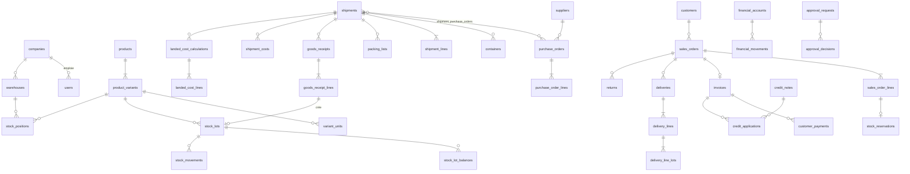

# 03 — Modèle de données MySQL

**Version :** 1.0 — 4 novembre 2026
**SGBD :** MySQL 8.4 LTS, InnoDB, `utf8mb4_0900_ai_ci`, `sql_mode` strict (D-001)

---

## 1. Conventions

### 1.1. Types de domaine

| Alias | Type MySQL | Usage |
|---|---|---|
| `ULID` | `CHAR(26) CHARACTER SET ascii COLLATE ascii_bin` | Clés primaires et étrangères métier (D-002) |
| `MONEY` | `DECIMAL(19,4)` | Montants (devise portée par le document ou la ligne) |
| `UCOST` | `DECIMAL(24,8)` | Coûts unitaires et calculs intermédiaires (CR-008) |
| `RATE` | `DECIMAL(20,10)` | Taux de change (1 unité devise source = *rate* devise cible) |
| `PCT` | `DECIMAL(9,6)` | Pourcentages (remises, taxes) exprimés en % |
| `QTY` | `BIGINT` | Quantités en **unité de base entière** (D-007) ; signée seulement dans `stock_movements` |
| `CBM` | `DECIMAL(14,6)` | Volumes en m³ |
| `CUR` | `CHAR(3) CHARACTER SET ascii` | Code ISO 4217 → `currencies.code` |
| `TS` | `TIMESTAMP(6)` | Horodatages UTC (affichage Africa/Dakar) |

### 1.2. Colonnes standard

- `-- STD` dans les définitions ci-dessous signifie :
  ```sql
  created_at TS NOT NULL DEFAULT CURRENT_TIMESTAMP(6),
  updated_at TS NOT NULL DEFAULT CURRENT_TIMESTAMP(6) ON UPDATE CURRENT_TIMESTAMP(6),
  created_by ULID NULL,   -- id utilisateur, sans FK (D-065)
  updated_by ULID NULL    -- id utilisateur, sans FK (D-065)
  ```
- `-- TENANT` signifie :
  ```sql
  company_id ULID NOT NULL,
  UNIQUE KEY uq_<table>_tenant (company_id, id),
  CONSTRAINT fk_<table>_company FOREIGN KEY (company_id) REFERENCES companies(id)
  ```
- `-- APPEND-ONLY` : la table n'a pas `updated_at` ; déclencheurs `BEFORE UPDATE` et `BEFORE DELETE` levant `SIGNAL SQLSTATE '45000'` (D-038).
- Clé étrangère intra-entreprise notée `FK⊂ parent` = contrainte **composite** `(company_id, x_id) REFERENCES parent(company_id, id)` (D-003).
- Toutes les FK sont `ON DELETE RESTRICT ON UPDATE RESTRICT` sauf mention contraire.
- Un `version INT NOT NULL DEFAULT 1` (verrouillage optimiste) est présent sur les documents modifiables par l'interface (brouillons).
- Les énumérations sont des `VARCHAR(32)` contrôlées par `CHECK (col IN (...))` et par les enums PHP (évolution plus simple que `ENUM`).
- Pas de suppression logique générique (`deleted_at`) sur les documents métier : statut `archived`/`cancelled` (CDC §17.3). Suppression physique uniquement pour les données de référence sans historique.

### 1.3. Séparation global / entreprise

| Portée | Tables |
|---|---|
| **Globale** (pas de `company_id`) | `companies`, `currencies`, `permissions`, `platform_settings`, `backup_records`, tables techniques Laravel (`jobs`, `failed_jobs`, `job_batches`, `cache`, `migrations`) |
| **Mixte** (`company_id` NULL autorisé) | `users` (NULL = super-admin), `roles` (NULL = modèle système), `audit_logs` (NULL = action plateforme), `sessions`, `notifications` |
| **Entreprise** | Toutes les autres |

---

## 2. Diagramme des relations principales



---

## 3. Plateforme, identité et accès

```sql
CREATE TABLE currencies (
  code       CUR PRIMARY KEY,                 -- 'XOF', 'CNY', 'USD', 'EUR'
  name       VARCHAR(64) NOT NULL,
  decimals   TINYINT UNSIGNED NOT NULL,       -- XOF = 0
  symbol     VARCHAR(8) NOT NULL,
  CHECK (decimals <= 4)
);

CREATE TABLE companies (
  id                 ULID PRIMARY KEY,
  code               VARCHAR(32) NOT NULL UNIQUE,         -- identifiant court, ex. FDS
  trade_name         VARCHAR(160) NOT NULL,
  legal_name         VARCHAR(200) NULL,
  ninea              VARCHAR(32) NULL,
  rccm               VARCHAR(64) NULL,
  address            VARCHAR(255) NULL,
  city               VARCHAR(100) NULL,
  country_code       CHAR(2) NOT NULL DEFAULT 'SN',
  phone              VARCHAR(32) NULL,
  email              VARCHAR(190) NULL,
  logo_file_id       ULID NULL,                           -- FK files(id), ajoutée après création de files
  reference_currency CUR NOT NULL,
  timezone           VARCHAR(64) NOT NULL DEFAULT 'Africa/Dakar',
  status             VARCHAR(16) NOT NULL DEFAULT 'provisioning',
  suspended_at       TS NULL,
  suspension_reason  VARCHAR(255) NULL,
  -- STD
  CONSTRAINT fk_companies_currency FOREIGN KEY (reference_currency) REFERENCES currencies(code),
  CHECK (status IN ('provisioning','active','suspended','archived')),
  KEY ix_companies_status (status)
);

CREATE TABLE users (
  id                 ULID PRIMARY KEY,
  company_id         ULID NULL,                           -- NULL ⇔ super-administrateur
  is_super_admin     BOOLEAN NOT NULL DEFAULT FALSE,
  name               VARCHAR(160) NOT NULL,
  email              VARCHAR(190) NOT NULL,
  email_verified_at  TS NULL,
  password           VARCHAR(255) NOT NULL,               -- Argon2id
  phone              VARCHAR(32) NULL,
  status             VARCHAR(16) NOT NULL DEFAULT 'invited',
  last_login_at      TS NULL,
  theme              VARCHAR(8) NOT NULL DEFAULT 'system',
  two_factor_secret  TEXT NULL,                           -- chiffré, optionnel (D-040)
  remember_token     VARCHAR(100) NULL,
  session_epoch      INT UNSIGNED NOT NULL DEFAULT 0,     -- révocation des sessions (D-069)
  -- STD
  UNIQUE KEY uq_users_email (email),                      -- un e-mail = un compte = une entreprise
  UNIQUE KEY uq_users_tenant (company_id, id),
  CONSTRAINT fk_users_company FOREIGN KEY (company_id) REFERENCES companies(id),
  CHECK ((is_super_admin = TRUE AND company_id IS NULL) OR (is_super_admin = FALSE AND company_id IS NOT NULL)),
  CHECK (status IN ('invited','active','disabled')),
  KEY ix_users_company_status (company_id, status)
);
-- Déclencheur : company_id non modifiable après création (règle « une seule entreprise »).

CREATE TABLE invitations (
  id            ULID PRIMARY KEY,
  -- TENANT
  email         VARCHAR(190) NOT NULL,
  role_id       ULID NOT NULL,                            -- FK⊂ roles
  token_hash    CHAR(64) NOT NULL UNIQUE,                 -- SHA-256 du jeton
  expires_at    TS NOT NULL,
  accepted_at   TS NULL,
  revoked_at    TS NULL,
  user_id       ULID NULL,
  -- STD
  KEY ix_invitations_email (company_id, email)
);

CREATE TABLE password_reset_tokens (                     -- table Laravel
  email       VARCHAR(190) PRIMARY KEY,
  token       VARCHAR(255) NOT NULL,                      -- haché
  created_at  TS NULL
);

CREATE TABLE sessions (                                  -- si driver database (sinon Redis)
  id            VARCHAR(255) PRIMARY KEY,
  user_id       ULID NULL,
  company_id    ULID NULL,                                -- entreprise active (super-admin)
  ip_address    VARCHAR(45) NULL,
  user_agent    TEXT NULL,
  payload       LONGTEXT NOT NULL,
  last_activity INT NOT NULL,
  KEY ix_sessions_user (user_id),
  KEY ix_sessions_last_activity (last_activity)
);

CREATE TABLE permissions (                               -- catalogue global, seedé
  id          BIGINT UNSIGNED AUTO_INCREMENT PRIMARY KEY,
  name        VARCHAR(96) NOT NULL,                       -- ex. 'sales_orders.confirm'
  guard_name  VARCHAR(32) NOT NULL DEFAULT 'web',
  module      VARCHAR(32) NOT NULL,
  label       VARCHAR(160) NOT NULL,                      -- libellé français (catalogue PermissionCatalog)
  is_sensitive BOOLEAN NOT NULL DEFAULT FALSE,
  UNIQUE KEY uq_permissions_name (name, guard_name)
);

CREATE TABLE roles (
  id          ULID PRIMARY KEY,
  company_id  ULID NULL,                                  -- NULL = modèle système (vendeur, magasinier, comptable, admin)
  name        VARCHAR(64) NOT NULL,
  guard_name  VARCHAR(32) NOT NULL DEFAULT 'web',
  is_system   BOOLEAN NOT NULL DEFAULT FALSE,
  template_code VARCHAR(32) NULL,                         -- 'seller','storekeeper','accountant','company_admin'
  -- STD
  UNIQUE KEY uq_roles_name (company_id, name, guard_name),
  UNIQUE KEY uq_roles_tenant (company_id, id),
  CONSTRAINT fk_roles_company FOREIGN KEY (company_id) REFERENCES companies(id)
);

CREATE TABLE role_has_permissions (                      -- nommage spatie
  permission_id BIGINT UNSIGNED NOT NULL,
  role_id       ULID NOT NULL,
  PRIMARY KEY (permission_id, role_id),
  FOREIGN KEY (permission_id) REFERENCES permissions(id) ON DELETE CASCADE,
  FOREIGN KEY (role_id) REFERENCES roles(id) ON DELETE CASCADE
);

CREATE TABLE model_has_roles (                           -- user_roles, mode teams : team = company
  role_id     ULID NOT NULL,
  model_type  VARCHAR(128) NOT NULL,
  model_id    ULID NOT NULL,
  company_id  ULID NOT NULL,
  PRIMARY KEY (company_id, role_id, model_id, model_type),
  FOREIGN KEY (company_id, role_id) REFERENCES roles(company_id, id),
  KEY ix_mhr_model (model_id, model_type)
);
-- model_has_permissions existe (lue par spatie) mais reste vide : permissions accordées uniquement via rôles (D-070).

CREATE TABLE platform_settings (
  `key`      VARCHAR(96) PRIMARY KEY,
  value      JSON NOT NULL,
  updated_at TS NOT NULL,
  updated_by ULID NULL
);

CREATE TABLE audit_logs (                                -- APPEND-ONLY
  id            ULID PRIMARY KEY,
  company_id    ULID NULL,
  user_id       ULID NULL,
  impersonated_company_id ULID NULL,                      -- entreprise active du super-admin
  action        VARCHAR(96) NOT NULL,                     -- 'sales_order.confirmed', 'auth.login_failed'…
  subject_type  VARCHAR(64) NULL,
  subject_id    ULID NULL,
  old_values    JSON NULL,
  new_values    JSON NULL,
  reason        VARCHAR(500) NULL,
  ip_address    VARCHAR(45) NULL,
  user_agent    VARCHAR(255) NULL,
  request_id    CHAR(26) NULL,
  occurred_at   TS NOT NULL DEFAULT CURRENT_TIMESTAMP(6),
  KEY ix_audit_company_time (company_id, occurred_at),
  KEY ix_audit_subject (company_id, subject_type, subject_id),
  KEY ix_audit_user (user_id, occurred_at),
  KEY ix_audit_action (company_id, action, occurred_at)
);

CREATE TABLE idempotency_keys (                          -- D-064
  id              ULID PRIMARY KEY,
  company_id      ULID NULL,
  user_id         ULID NULL,                              -- NULL pour les routes sans session
  owner           VARCHAR(80) NOT NULL,                   -- 'user:{id}' ou 'anon:{ip}'
  idempotency_key VARCHAR(64) NOT NULL,
  route           VARCHAR(160) NOT NULL,                  -- 'POST api/v1/...'
  request_hash    CHAR(64) NOT NULL,
  status          VARCHAR(16) NOT NULL,                   -- processing, completed
  response_code   SMALLINT UNSIGNED NULL,
  response_headers JSON NULL,                             -- Content-Type, Location
  response_body   MEDIUMTEXT NULL,                        -- rejouée telle quelle
  locked_at       TS NULL,                                -- reprise possible après 120 s
  expires_at      TS NOT NULL,                            -- 24 h
  created_at      TS NOT NULL DEFAULT CURRENT_TIMESTAMP(6),
  UNIQUE KEY uq_idem_owner_key (owner, idempotency_key),
  KEY ix_idem_expiry (expires_at)
);

CREATE TABLE notifications (                             -- notifications Laravel + company_id
  id               CHAR(36) PRIMARY KEY,
  company_id       ULID NULL,
  type             VARCHAR(190) NOT NULL,
  notifiable_type  VARCHAR(128) NOT NULL,
  notifiable_id    ULID NOT NULL,
  data             JSON NOT NULL,
  read_at          TS NULL,
  created_at       TS NULL,
  updated_at       TS NULL,
  KEY ix_notif_target (notifiable_type, notifiable_id, read_at)
);

CREATE TABLE backup_records (                            -- global
  id            ULID PRIMARY KEY,
  kind          VARCHAR(16) NOT NULL,                     -- scheduled, manual, restore_test
  status        VARCHAR(16) NOT NULL,                     -- running, succeeded, failed
  started_at    TS NOT NULL,
  finished_at   TS NULL,
  snapshot_id   VARCHAR(64) NULL,                         -- identifiant restic
  size_bytes    BIGINT UNSIGNED NULL,
  db_dump_sha256 CHAR(64) NULL,
  error_message TEXT NULL,
  triggered_by  ULID NULL,
  CHECK (status IN ('running','succeeded','failed')),
  KEY ix_backup_started (started_at)
);
```

---

## 4. Paramètres entreprise et référentiels

```sql
CREATE TABLE company_settings (                          -- 1 ligne par entreprise
  company_id               ULID PRIMARY KEY,
  default_sales_warehouse_id ULID NULL,                   -- FK⊂ warehouses (ajoutée après)
  default_payment_terms_days SMALLINT UNSIGNED NOT NULL DEFAULT 0,
  rounding_mode            VARCHAR(16) NOT NULL DEFAULT 'half_up',
  low_stock_default_threshold INT UNSIGNED NOT NULL DEFAULT 0,
  invoice_legal_mentions   TEXT NULL,                     -- VÉRIF. RÉGL.
  invoice_footer           TEXT NULL,
  payment_instructions     TEXT NULL,
  start_date               DATE NULL,                     -- date de démarrage (ouverture)
  allow_self_approval      BOOLEAN NOT NULL DEFAULT TRUE, -- [VALIDÉ-CDC §16.2]
  extra                    JSON NULL,
  updated_at TS NOT NULL, updated_by ULID NULL,
  FOREIGN KEY (company_id) REFERENCES companies(id),
  CHECK (rounding_mode IN ('half_up'))
);

CREATE TABLE document_sequences (
  id            ULID PRIMARY KEY,
  -- TENANT
  doc_type      VARCHAR(24) NOT NULL,                     -- invoice, credit_note, receipt, quotation, sales_order, delivery, purchase_order, goods_receipt, transfer, inventory, return, expense, adjustment
  period_year   SMALLINT UNSIGNED NOT NULL,               -- 0 si séquence non annuelle
  prefix        VARCHAR(12) NOT NULL,                     -- 'FAC'
  padding       TINYINT UNSIGNED NOT NULL DEFAULT 4,
  next_number   INT UNSIGNED NOT NULL DEFAULT 1,
  -- STD
  UNIQUE KEY uq_docseq (company_id, doc_type, period_year)
);
-- Attribution : SELECT … FOR UPDATE puis UPDATE next_number+1 dans la transaction du document (D-030).

CREATE TABLE document_sequence_formats (                 -- D-073 : préfixe et largeur choisis par l'entreprise
  id        ULID PRIMARY KEY,
  -- TENANT
  doc_type  VARCHAR(24) NOT NULL,
  prefix    VARCHAR(12) NOT NULL,                         -- [A-Z0-9]{1,12}
  padding   TINYINT UNSIGNED NOT NULL DEFAULT 4,          -- 1 à 10
  -- STD
  UNIQUE KEY uq_docfmt (company_id, doc_type)
);
-- Format : {prefix}-{AAAA}-{numéro complété de zéros} ; FAC-2026-0001. Au-delà de 9999, la largeur s'étend (FAC-2026-10000).

CREATE TABLE exchange_rates (
  id             ULID PRIMARY KEY,
  -- TENANT
  from_currency  CUR NOT NULL,
  to_currency    CUR NOT NULL,                            -- en pratique la devise de référence
  rate           RATE NOT NULL,
  valid_on       DATE NOT NULL,
  source         VARCHAR(64) NULL,                        -- 'saisie', 'banque X'…
  -- STD
  FOREIGN KEY (from_currency) REFERENCES currencies(code),
  FOREIGN KEY (to_currency) REFERENCES currencies(code),
  CHECK (rate > 0), CHECK (from_currency <> to_currency),
  UNIQUE KEY uq_rate (company_id, from_currency, to_currency, valid_on)
);

CREATE TABLE tax_rates (                                 -- M-01 : vide par défaut
  id          ULID PRIMARY KEY,
  -- TENANT
  name        VARCHAR(64) NOT NULL,
  rate        PCT NOT NULL,
  is_active   BOOLEAN NOT NULL DEFAULT TRUE,
  -- STD
  CHECK (rate >= 0 AND rate <= 100),
  UNIQUE KEY uq_tax_name (company_id, name)
);

CREATE TABLE files (
  id             ULID PRIMARY KEY,
  -- TENANT
  disk           VARCHAR(16) NOT NULL DEFAULT 'private',
  path           VARCHAR(255) NOT NULL,                   -- companies/{company_id}/{yyyy}/{mm}/{ulid}.{ext}
  original_name  VARCHAR(255) NOT NULL,
  mime_type      VARCHAR(96) NOT NULL,                    -- détecté par finfo
  size_bytes     INT UNSIGNED NOT NULL,
  sha256         CHAR(64) NOT NULL,
  purpose        VARCHAR(32) NOT NULL,                    -- product_image, supplier_doc, shipment_doc, packing_list, import, expense_receipt, generated_pdf, export, logo
  -- STD
  UNIQUE KEY uq_files_path (path),
  KEY ix_files_purpose (company_id, purpose)
);
ALTER TABLE companies ADD CONSTRAINT fk_companies_logo FOREIGN KEY (logo_file_id) REFERENCES files(id);

CREATE TABLE attachments (                               -- pièces jointes polymorphes
  id               ULID PRIMARY KEY,
  -- TENANT
  file_id          ULID NOT NULL,                         -- FK⊂ files
  attachable_type  VARCHAR(64) NOT NULL,
  attachable_id    ULID NOT NULL,
  label            VARCHAR(160) NULL,
  -- STD
  KEY ix_attach_target (company_id, attachable_type, attachable_id)
);

CREATE TABLE generated_documents (
  id            ULID PRIMARY KEY,
  -- TENANT
  doc_type      VARCHAR(24) NOT NULL,                     -- invoice, credit_note, receipt, quotation, delivery_note, purchase_order, statement, inventory_sheet, report
  source_type   VARCHAR(64) NOT NULL,
  source_id     ULID NOT NULL,
  revision      SMALLINT UNSIGNED NOT NULL DEFAULT 1,
  file_id       ULID NOT NULL,                            -- FK⊂ files
  content_sha256 CHAR(64) NOT NULL,
  -- STD
  UNIQUE KEY uq_gendoc (company_id, source_type, source_id, doc_type, revision)
);

CREATE TABLE share_links (                               -- liens WhatsApp signés
  id            ULID PRIMARY KEY,
  -- TENANT
  generated_document_id ULID NOT NULL,                    -- FK⊂ generated_documents
  token_hash    CHAR(64) NOT NULL UNIQUE,
  expires_at    TS NOT NULL,
  revoked_at    TS NULL,
  download_count INT UNSIGNED NOT NULL DEFAULT 0,
  -- STD
);
```

---

## 5. Catalogue

```sql
CREATE TABLE categories (
  id          ULID PRIMARY KEY,
  -- TENANT
  parent_id   ULID NULL,                                  -- FK⊂ categories
  name        VARCHAR(120) NOT NULL,
  path        VARCHAR(1000) NOT NULL,                     -- matérialisé : /ulid1/ulid2/
  is_active   BOOLEAN NOT NULL DEFAULT TRUE,
  -- STD
  parent_key  CHAR(26) AS (COALESCE(parent_id, '')) STORED, -- unicité du nom à la racine
  UNIQUE KEY uq_cat_name (company_id, parent_key, name),
  KEY ix_cat_path (company_id, path(191))
);

CREATE TABLE products (
  id            ULID PRIMARY KEY,
  -- TENANT
  reference     VARCHAR(64) NOT NULL,
  name          VARCHAR(200) NOT NULL,
  description   TEXT NULL,
  category_id   ULID NULL,                                -- FK⊂ categories
  product_type  VARCHAR(16) NOT NULL DEFAULT 'stock',     -- stock | service (D-050)
  base_unit_label VARCHAR(16) NOT NULL DEFAULT 'pièce',
  has_variants  BOOLEAN NOT NULL DEFAULT FALSE,
  status        VARCHAR(16) NOT NULL DEFAULT 'active',    -- active, inactive, archived
  has_history   BOOLEAN NOT NULL DEFAULT FALSE,           -- positionné au 1er mouvement/achat/vente : interdit la suppression (§5.4)
  -- STD
  version INT NOT NULL DEFAULT 1,
  UNIQUE KEY uq_products_ref (company_id, reference),
  CHECK (product_type IN ('stock','service')),
  CHECK (status IN ('active','inactive','archived')),
  KEY ix_products_category (company_id, category_id),
  KEY ix_products_status_name (company_id, status, name),
  FULLTEXT KEY ft_products (reference, name, description) WITH PARSER ngram
);

CREATE TABLE attributes (                                -- Couleur, Taille, Modèle…
  id ULID PRIMARY KEY,
  -- TENANT
  name VARCHAR(64) NOT NULL,
  -- STD
  UNIQUE KEY uq_attr (company_id, name)
);

CREATE TABLE attribute_values (
  id ULID PRIMARY KEY,
  -- TENANT
  attribute_id ULID NOT NULL,                             -- FK⊂ attributes
  value VARCHAR(64) NOT NULL,
  position SMALLINT UNSIGNED NOT NULL DEFAULT 0,
  -- STD
  UNIQUE KEY uq_attr_val (company_id, attribute_id, value)
);

CREATE TABLE product_variants (                          -- D-008 : toujours ≥ 1 par produit
  id                  ULID PRIMARY KEY,
  -- TENANT
  product_id          ULID NOT NULL,                      -- FK⊂ products
  sku                 VARCHAR(64) NOT NULL,               -- référence commerciale de la variante
  label               VARCHAR(160) NOT NULL,              -- « Rouge / XL » ou nom du produit
  is_default          BOOLEAN NOT NULL DEFAULT FALSE,
  pieces_per_carton   INT UNSIGNED NULL,                  -- raccourci ; la vérité est variant_units
  low_stock_threshold INT UNSIGNED NULL,                  -- NULL = seuil produit/entreprise
  status              VARCHAR(16) NOT NULL DEFAULT 'active',
  -- STD
  UNIQUE KEY uq_variants_sku (company_id, sku),
  KEY ix_variants_product (company_id, product_id),
  CHECK (pieces_per_carton IS NULL OR pieces_per_carton > 0)
);

CREATE TABLE variant_attribute_values (
  -- TENANT (sans id propre)
  company_id ULID NOT NULL,
  variant_id ULID NOT NULL,                               -- FK⊂ product_variants
  attribute_value_id ULID NOT NULL,                       -- FK⊂ attribute_values
  PRIMARY KEY (company_id, variant_id, attribute_value_id)
);

CREATE TABLE variant_units (                             -- fusion product_units + unit_conversions
  id            ULID PRIMARY KEY,
  -- TENANT
  variant_id    ULID NOT NULL,                            -- FK⊂ product_variants
  code          VARCHAR(16) NOT NULL,                     -- 'piece', 'carton', 'paquet'
  label         VARCHAR(32) NOT NULL,
  factor        INT UNSIGNED NOT NULL,                    -- nb d'unités de base ; pièce = 1
  barcode       VARCHAR(64) NULL,                         -- M-05
  is_sellable   BOOLEAN NOT NULL DEFAULT TRUE,
  locked_at     TS NULL,                                  -- facteur figé au premier usage (CAT-007, D-083)
  -- STD
  UNIQUE KEY uq_vunit (company_id, variant_id, code),
  UNIQUE KEY uq_vunit_barcode (company_id, barcode),      -- NULL multiples autorisés
  CHECK (factor >= 1)
);

CREATE TABLE product_images (
  id          ULID PRIMARY KEY,
  -- TENANT
  product_id  ULID NOT NULL,                              -- FK⊂ products
  variant_id  ULID NULL,                                  -- FK⊂ product_variants
  file_id     ULID NOT NULL,                              -- FK⊂ files
  thumb_file_id ULID NULL,                                -- FK⊂ files
  position    SMALLINT UNSIGNED NOT NULL DEFAULT 0,
  -- STD
  KEY ix_pimg (company_id, product_id, position)
);

CREATE TABLE price_lists (                               -- 'Détail', 'Gros'
  id          ULID PRIMARY KEY,
  -- TENANT
  code        VARCHAR(16) NOT NULL,                       -- retail, wholesale
  name        VARCHAR(64) NOT NULL,
  currency    CUR NOT NULL,
  is_default  BOOLEAN NOT NULL DEFAULT FALSE,
  -- STD
  UNIQUE KEY uq_pl (company_id, code)
);

CREATE TABLE product_prices (
  id            ULID PRIMARY KEY,
  -- TENANT
  variant_id    ULID NOT NULL,                            -- FK⊂ product_variants
  price_list_id ULID NOT NULL,                            -- FK⊂ price_lists
  unit_id       ULID NOT NULL,                            -- FK⊂ variant_units
  price         MONEY NOT NULL,
  valid_from    DATE NOT NULL,
  valid_to      DATE NULL,                                -- NULL = en vigueur
  -- STD
  CHECK (price >= 0),
  CHECK (valid_to IS NULL OR valid_to >= valid_from),
  UNIQUE KEY uq_price (company_id, variant_id, price_list_id, unit_id, valid_from),
  KEY ix_price_lookup (company_id, variant_id, price_list_id, unit_id, valid_to)
);
-- Invariant applicatif : pas de chevauchement de périodes pour un même (variante, grille, unité).
```

---

## 6. Dépôts et stocks

```sql
CREATE TABLE warehouses (
  id          ULID PRIMARY KEY,
  -- TENANT
  code        VARCHAR(16) NOT NULL,
  name        VARCHAR(120) NOT NULL,
  address     VARCHAR(255) NULL,
  status      VARCHAR(16) NOT NULL DEFAULT 'active',      -- active, inactive
  -- STD
  UNIQUE KEY uq_wh_code (company_id, code),
  UNIQUE KEY uq_wh_name (company_id, name)
);
ALTER TABLE company_settings ADD CONSTRAINT fk_cs_wh
  FOREIGN KEY (company_id, default_sales_warehouse_id) REFERENCES warehouses(company_id, id);

CREATE TABLE stock_lots (
  id                 ULID PRIMARY KEY,
  -- TENANT
  lot_number         VARCHAR(40) NOT NULL,                -- LOT-2026-000123
  variant_id         ULID NOT NULL,                       -- FK⊂ product_variants
  origin_type        VARCHAR(16) NOT NULL,                -- receipt, opening, adjustment
  origin_id          ULID NULL,                           -- goods_receipt_line / opening / adjustment_line
  shipment_id        ULID NULL,                           -- FK⊂ shipments (rentabilité des arrivages)
  received_at        TS NOT NULL,                         -- base du tri FIFO
  initial_qty        QTY NOT NULL,
  unit_cost          UCOST NOT NULL,                      -- en devise de référence
  cost_currency      CUR NOT NULL,
  cost_status        VARCHAR(16) NOT NULL,                -- provisional, final (D-012)
  landed_cost_calculation_id ULID NULL,                   -- FK⊂ landed_cost_calculations
  cost_breakdown     JSON NULL,                           -- détail achat converti / frais par catégorie / taux
  -- STD
  UNIQUE KEY uq_lot_number (company_id, lot_number),
  KEY ix_lot_fifo (company_id, variant_id, received_at),
  KEY ix_lot_shipment (company_id, shipment_id),
  CHECK (initial_qty > 0), CHECK (unit_cost >= 0),
  CHECK (origin_type IN ('receipt','opening','adjustment')),
  CHECK (cost_status IN ('provisional','final'))
);
-- Déclencheur : unit_cost modifiable uniquement si cost_status passe de 'provisional' à 'final' (CR-004).

CREATE TABLE stock_positions (                           -- projection dépôt × variante, point de verrouillage
  id             ULID PRIMARY KEY,
  -- TENANT
  warehouse_id   ULID NOT NULL,                           -- FK⊂ warehouses
  variant_id     ULID NOT NULL,                           -- FK⊂ product_variants
  qty_on_hand    QTY NOT NULL DEFAULT 0,                  -- physiquement présent (inclut en_livraison et bloqué)
  qty_reserved   QTY NOT NULL DEFAULT 0,
  qty_blocked    QTY NOT NULL DEFAULT 0,
  qty_in_delivery QTY NOT NULL DEFAULT 0,
  qty_available  QTY AS (qty_on_hand - qty_reserved - qty_blocked - qty_in_delivery) STORED,
  last_movement_at TS NULL,
  updated_at     TS NOT NULL DEFAULT CURRENT_TIMESTAMP(6) ON UPDATE CURRENT_TIMESTAMP(6),
  UNIQUE KEY uq_pos (company_id, warehouse_id, variant_id),
  KEY ix_pos_variant (company_id, variant_id),
  KEY ix_pos_available (company_id, warehouse_id, qty_available),
  CONSTRAINT ck_pos_nonneg CHECK (qty_on_hand >= 0 AND qty_reserved >= 0 AND qty_blocked >= 0 AND qty_in_delivery >= 0),
  CONSTRAINT ck_pos_available CHECK (qty_on_hand - qty_reserved - qty_blocked - qty_in_delivery >= 0)  -- ST-006, ST-007
);

CREATE TABLE stock_lot_balances (                        -- projection dépôt × lot
  id             ULID PRIMARY KEY,
  -- TENANT
  warehouse_id   ULID NOT NULL,                           -- FK⊂ warehouses
  lot_id         ULID NOT NULL,                           -- FK⊂ stock_lots
  variant_id     ULID NOT NULL,                           -- dénormalisé (index FIFO)
  qty_on_hand    QTY NOT NULL DEFAULT 0,
  qty_blocked    QTY NOT NULL DEFAULT 0,
  qty_in_delivery QTY NOT NULL DEFAULT 0,                 -- lots affectés aux livraisons expédiées
  updated_at     TS NOT NULL DEFAULT CURRENT_TIMESTAMP(6) ON UPDATE CURRENT_TIMESTAMP(6),
  UNIQUE KEY uq_lotbal (company_id, warehouse_id, lot_id),
  KEY ix_lotbal_fifo (company_id, warehouse_id, variant_id, qty_on_hand),
  CHECK (qty_on_hand >= 0 AND qty_blocked >= 0 AND qty_in_delivery >= 0),
  CHECK (qty_on_hand - qty_blocked - qty_in_delivery >= 0)
);

CREATE TABLE stock_movements (                           -- APPEND-ONLY, source de vérité du physique
  id              ULID PRIMARY KEY,
  -- TENANT
  warehouse_id    ULID NOT NULL,                          -- FK⊂ warehouses
  variant_id      ULID NOT NULL,                          -- FK⊂ product_variants
  lot_id          ULID NOT NULL,                          -- FK⊂ stock_lots
  movement_type   VARCHAR(24) NOT NULL,
  quantity        QTY NOT NULL,                           -- signée : + entrée, − sortie
  unit_cost       UCOST NOT NULL,                         -- coût du lot au moment du mouvement
  total_cost      MONEY NOT NULL,                         -- quantity × unit_cost (signé)
  source_type     VARCHAR(32) NOT NULL,                   -- goods_receipt, delivery, return, transfer, adjustment, opening, reversal
  source_id       ULID NOT NULL,
  source_line_id  ULID NOT NULL,
  reversal_seq    SMALLINT UNSIGNED NOT NULL DEFAULT 0,   -- 0 = original, n = n-ième contre-écriture
  reverses_movement_id ULID NULL,                         -- FK⊂ stock_movements
  reason          VARCHAR(255) NULL,
  occurred_at     TS NOT NULL,
  created_at      TS NOT NULL DEFAULT CURRENT_TIMESTAMP(6),
  created_by      ULID NOT NULL,
  CHECK (quantity <> 0),
  CHECK (movement_type IN ('receipt','sale_delivery','return_in','transfer_in','transfer_out',
         'adjustment_in','adjustment_out','loss','opening','reversal')),
  -- Anti-doublon (IMP-004, TEST-008) :
  UNIQUE KEY uq_mov_source (company_id, source_type, source_line_id, movement_type, lot_id, reversal_seq),
  KEY ix_mov_variant_time (company_id, variant_id, occurred_at),
  KEY ix_mov_wh_time (company_id, warehouse_id, occurred_at),
  KEY ix_mov_lot (company_id, lot_id),
  KEY ix_mov_source (company_id, source_type, source_id)
);

CREATE TABLE stock_reservations (                        -- réservation au niveau dépôt × variante (D-055)
  id             ULID PRIMARY KEY,
  -- TENANT
  warehouse_id   ULID NOT NULL,
  variant_id     ULID NOT NULL,
  source_type    VARCHAR(32) NOT NULL,                    -- sales_order_line
  source_id      ULID NOT NULL,
  qty_reserved   QTY NOT NULL,
  qty_consumed   QTY NOT NULL DEFAULT 0,                  -- passé en livraison / remis
  qty_released   QTY NOT NULL DEFAULT 0,                  -- libéré (annulation, rejet, réduction)
  qty_active     QTY AS (qty_reserved - qty_consumed - qty_released) STORED,
  is_provisional BOOLEAN NOT NULL DEFAULT FALSE,          -- commande en attente d'approbation
  status         VARCHAR(16) NOT NULL DEFAULT 'active',   -- active, closed
  -- STD
  UNIQUE KEY uq_resa_source (company_id, source_type, source_id),
  KEY ix_resa_pos (company_id, warehouse_id, variant_id, status),
  CHECK (qty_reserved > 0 AND qty_consumed >= 0 AND qty_released >= 0),
  CHECK (qty_consumed + qty_released <= qty_reserved)
);

CREATE TABLE stock_holds (                               -- stock bloqué : endommagé, ajustement en attente…
  id             ULID PRIMARY KEY,
  -- TENANT
  warehouse_id   ULID NOT NULL,
  variant_id     ULID NOT NULL,
  lot_id         ULID NOT NULL,                           -- FK⊂ stock_lots
  reason         VARCHAR(24) NOT NULL,                    -- damaged, pending_adjustment, return_inspection, quality, other
  qty_held       QTY NOT NULL,
  qty_released   QTY NOT NULL DEFAULT 0,
  qty_consumed   QTY NOT NULL DEFAULT 0,                  -- sorti (perte validée)
  qty_active     QTY AS (qty_held - qty_released - qty_consumed) STORED,
  source_type    VARCHAR(32) NOT NULL,
  source_id      ULID NOT NULL,
  note           VARCHAR(255) NULL,
  status         VARCHAR(16) NOT NULL DEFAULT 'active',
  -- STD
  KEY ix_hold_lot (company_id, warehouse_id, lot_id, status),
  CHECK (qty_held > 0 AND qty_released + qty_consumed <= qty_held)
);

CREATE TABLE stock_adjustments (                         -- ajustements manuels ou issus d'inventaire
  id               ULID PRIMARY KEY,
  -- TENANT
  number           VARCHAR(32) NOT NULL,                  -- AJU-2026-0001
  warehouse_id     ULID NOT NULL,
  inventory_id     ULID NULL,                             -- FK⊂ inventories
  transfer_id      ULID NULL,                             -- FK⊂ stock_transfers (perte d'un transfert, D-078)
  status           VARCHAR(24) NOT NULL DEFAULT 'draft',  -- draft, pending_approval, posted, rejected, cancelled
  reason           VARCHAR(255) NULL,                     -- obligatoire si règle d'approbation l'exige
  approval_request_id ULID NULL,
  posted_at        TS NULL,
  -- STD
  version INT NOT NULL DEFAULT 1,
  UNIQUE KEY uq_adj_number (company_id, number),
  KEY ix_adj_status (company_id, status)
);

CREATE TABLE stock_adjustment_lines (
  id               ULID PRIMARY KEY,
  -- TENANT
  adjustment_id    ULID NOT NULL,                         -- FK⊂ stock_adjustments
  variant_id       ULID NOT NULL,
  lot_id           ULID NULL,                             -- NULL pour un ajustement positif ⇒ lot d'ajustement créé (D-048)
  quantity         QTY NOT NULL,                          -- signée
  kind             VARCHAR(16) NOT NULL,                  -- gain, loss, damage, correction (inventaire)
  unit_cost        UCOST NULL,                            -- requis si positif
  hold_id          ULID NULL,                             -- blocage provisoire pendant l'approbation
  created_lot_id   ULID NULL,                             -- lot créé par une entrée
  -- STD
  CHECK (quantity <> 0)
);

CREATE TABLE inventories (
  id             ULID PRIMARY KEY,
  -- TENANT
  number         VARCHAR(32) NOT NULL,                    -- INV-2026-0001
  warehouse_id   ULID NOT NULL,
  scope          VARCHAR(16) NOT NULL,                    -- full, partial
  scope_filter   JSON NULL,                               -- catégories / variantes pour un partiel
  status         VARCHAR(16) NOT NULL DEFAULT 'draft',    -- draft, counting, review, validated, cancelled
  snapshot_at    TS NULL,                                 -- figeage des quantités théoriques
  validated_at   TS NULL,
  adjustment_id  ULID NULL,                               -- FK⊂ stock_adjustments
  -- STD
  version INT NOT NULL DEFAULT 1,
  UNIQUE KEY uq_inv_number (company_id, number)
);
-- Invariant : un seul inventaire non clôturé par (dépôt, variante) — contrôlé applicativement + verrou.

CREATE TABLE inventory_lines (
  id             ULID PRIMARY KEY,
  -- TENANT
  inventory_id   ULID NOT NULL,                           -- FK⊂ inventories
  variant_id     ULID NOT NULL,
  lot_id         ULID NULL,
  qty_expected   QTY NOT NULL,                            -- au snapshot
  qty_counted    QTY NULL,
  qty_difference QTY AS (qty_counted - qty_expected) STORED,
  counted_by     ULID NULL,
  counted_at     TS NULL,
  note           VARCHAR(255) NULL,
  -- STD
  lot_key        CHAR(26) AS (COALESCE(lot_id, '')) STORED,
  UNIQUE KEY uq_invline (company_id, inventory_id, variant_id, lot_key),
  CHECK (qty_counted IS NULL OR qty_counted >= 0)
);

CREATE TABLE stock_transfers (
  id                ULID PRIMARY KEY,
  -- TENANT
  number            VARCHAR(32) NOT NULL,                 -- TRF-2026-0001
  from_warehouse_id ULID NOT NULL,
  to_warehouse_id   ULID NOT NULL,
  status            VARCHAR(16) NOT NULL DEFAULT 'draft', -- draft, confirmed, in_transit, received, cancelled
  shipped_at        TS NULL,
  received_at       TS NULL,
  note              VARCHAR(255) NULL,
  -- STD
  version INT NOT NULL DEFAULT 1,
  UNIQUE KEY uq_trf_number (company_id, number),
  CHECK (from_warehouse_id <> to_warehouse_id),          -- MT-005 : même entreprise garantie par FK composites
  KEY ix_trf_status (company_id, status)
);

CREATE TABLE stock_transfer_lines (
  id             ULID PRIMARY KEY,
  -- TENANT
  transfer_id    ULID NOT NULL,
  variant_id     ULID NOT NULL,
  lot_id         ULID NULL,                               -- affecté au départ (FIFO proposé)
  parent_line_id ULID NULL,                               -- ligne d'origine en cas d'éclatement par lot
  qty_requested  QTY NOT NULL,
  qty_sent       QTY NOT NULL DEFAULT 0,
  qty_received   QTY NOT NULL DEFAULT 0,
  qty_discrepancy QTY AS (qty_sent - qty_received) STORED,
  -- STD
  CHECK (qty_requested > 0 AND qty_sent >= 0 AND qty_received >= 0 AND qty_received <= qty_sent)
);
-- Une ligne de transfert peut être éclatée en plusieurs lignes (une par lot) au départ.
```

---

## 7. Fournisseurs et achats

```sql
CREATE TABLE suppliers (
  id            ULID PRIMARY KEY,
  -- TENANT
  code          VARCHAR(32) NOT NULL,
  name          VARCHAR(200) NOT NULL,
  supplier_type VARCHAR(16) NOT NULL DEFAULT 'goods',     -- goods, forwarder, carrier, customs, other (M-12)
  country_code  CHAR(2) NULL,
  currency      CUR NOT NULL,
  phone         VARCHAR(32) NULL,
  email         VARCHAR(190) NULL,
  address       VARCHAR(255) NULL,
  contact_name  VARCHAR(120) NULL,
  notes         TEXT NULL,
  status        VARCHAR(16) NOT NULL DEFAULT 'active',
  has_history   BOOLEAN NOT NULL DEFAULT FALSE,
  -- STD
  UNIQUE KEY uq_sup_code (company_id, code),
  KEY ix_sup_name (company_id, name)
);

CREATE TABLE purchase_orders (
  id             ULID PRIMARY KEY,
  -- TENANT
  number         VARCHAR(32) NOT NULL,                    -- BC-2026-0001
  supplier_id    ULID NOT NULL,
  supplier_reference VARCHAR(64) NULL,
  order_date     DATE NOT NULL,
  currency       CUR NOT NULL,
  estimated_rate RATE NULL,                               -- taux indicatif vers devise de référence
  status         VARCHAR(24) NOT NULL DEFAULT 'draft',    -- draft, confirmed, partially_received, received, closed, cancelled
  total_amount   MONEY NOT NULL DEFAULT 0,                -- devise du BC
  notes          TEXT NULL,
  confirmed_at   TS NULL,
  -- STD
  version INT NOT NULL DEFAULT 1,
  UNIQUE KEY uq_po_number (company_id, number),
  KEY ix_po_supplier (company_id, supplier_id, status)
);

CREATE TABLE purchase_order_lines (
  id             ULID PRIMARY KEY,
  -- TENANT
  purchase_order_id ULID NOT NULL,
  variant_id     ULID NOT NULL,
  unit_id        ULID NOT NULL,                           -- FK⊂ variant_units
  unit_factor    INT UNSIGNED NOT NULL,                   -- figé
  qty_units      INT UNSIGNED NOT NULL,                   -- ex. 50 cartons
  qty_base       QTY NOT NULL,                            -- = qty_units × unit_factor
  unit_price     UCOST NOT NULL,                          -- devise du BC, par unité commandée
  line_total     MONEY NOT NULL,
  qty_received   QTY NOT NULL DEFAULT 0,                  -- unités de base
  -- STD
  CHECK (qty_units > 0 AND qty_base = qty_units * unit_factor),
  CHECK (qty_received >= 0)
);

CREATE TABLE supplier_bills (                            -- engagements / dettes (D-026)
  id             ULID PRIMARY KEY,
  -- TENANT
  number         VARCHAR(32) NOT NULL,                    -- interne ENG-2026-0001
  supplier_id    ULID NOT NULL,
  supplier_invoice_ref VARCHAR(64) NULL,
  source_type    VARCHAR(32) NOT NULL,                    -- purchase_order, shipment_cost, manual, supplier_credit
  source_id      ULID NULL,
  currency       CUR NOT NULL,
  amount         MONEY NOT NULL,                          -- négatif pour un avoir fournisseur
  amount_paid    MONEY NOT NULL DEFAULT 0,
  balance        MONEY AS (amount - amount_paid) STORED,
  bill_date      DATE NOT NULL,
  due_date       DATE NULL,
  status         VARCHAR(16) NOT NULL DEFAULT 'open',     -- open, partially_paid, paid, cancelled
  -- STD
  UNIQUE KEY uq_bill_number (company_id, number),
  KEY ix_bill_supplier (company_id, supplier_id, status),
  CHECK (amount <> 0)
);

CREATE TABLE supplier_payments (
  id                 ULID PRIMARY KEY,
  -- TENANT
  number             VARCHAR(32) NOT NULL,                -- PF-2026-0001
  supplier_id        ULID NOT NULL,
  financial_account_id ULID NOT NULL,                     -- FK⊂ financial_accounts
  paid_at            DATE NOT NULL,
  currency           CUR NOT NULL,                        -- devise de la dette réglée
  amount             MONEY NOT NULL,
  account_currency   CUR NOT NULL,
  account_amount     MONEY NOT NULL,                      -- montant débité du compte
  exchange_rate      RATE NOT NULL,                       -- CR-003 / A-07
  method             VARCHAR(16) NOT NULL,                -- cash, wave, orange_money, bank_transfer
  external_reference VARCHAR(64) NULL,
  status             VARCHAR(16) NOT NULL DEFAULT 'posted', -- posted, reversed
  reverses_payment_id ULID NULL,
  financial_movement_id ULID NULL,
  -- STD
  UNIQUE KEY uq_spay_number (company_id, number),
  KEY ix_spay_supplier (company_id, supplier_id, paid_at),
  CHECK (amount > 0 AND account_amount > 0 AND exchange_rate > 0)
);

CREATE TABLE supplier_payment_allocations (
  id                  ULID PRIMARY KEY,
  -- TENANT
  supplier_payment_id ULID NOT NULL,
  supplier_bill_id    ULID NOT NULL,
  amount              MONEY NOT NULL,                     -- devise de l'engagement
  created_at TS NOT NULL DEFAULT CURRENT_TIMESTAMP(6),
  UNIQUE KEY uq_spa (company_id, supplier_payment_id, supplier_bill_id),
  CHECK (amount > 0)
);
```

---

## 8. Arrivages, packing lists, réceptions

```sql
CREATE TABLE shipments (                                 -- arrivage (unité de calcul du coût de revient)
  id                 ULID PRIMARY KEY,
  -- TENANT
  number             VARCHAR(32) NOT NULL,                -- ARR-2026-0001
  carrier            VARCHAR(120) NULL,
  origin_country     CHAR(2) NULL,
  shipped_at         DATE NULL,
  eta                DATE NULL,
  arrived_at         DATE NULL,
  status             VARCHAR(24) NOT NULL DEFAULT 'preparing',
  default_warehouse_id ULID NULL,
  notes              TEXT NULL,
  -- STD
  version INT NOT NULL DEFAULT 1,
  UNIQUE KEY uq_shp_number (company_id, number),
  KEY ix_shp_status_eta (company_id, status, eta),
  CHECK (status IN ('preparing','shipped','in_transit','arrived','unloading','partially_received','received','closed','cancelled'))
);

CREATE TABLE containers (
  id             ULID PRIMARY KEY,
  -- TENANT
  shipment_id    ULID NOT NULL,
  container_number VARCHAR(20) NOT NULL,                  -- ex. MSCU1234567
  container_type VARCHAR(16) NULL,                        -- 20GP, 40HC…
  seal_number    VARCHAR(32) NULL,
  -- STD
  UNIQUE KEY uq_cont (company_id, shipment_id, container_number)
);

CREATE TABLE shipment_purchase_orders (
  company_id        ULID NOT NULL,
  shipment_id       ULID NOT NULL,
  purchase_order_id ULID NOT NULL,
  PRIMARY KEY (company_id, shipment_id, purchase_order_id)
);

CREATE TABLE shipment_lines (                            -- articles attendus
  id                 ULID PRIMARY KEY,
  -- TENANT
  shipment_id        ULID NOT NULL,
  container_id       ULID NULL,
  purchase_order_line_id ULID NULL,
  supplier_id        ULID NULL,
  variant_id         ULID NOT NULL,
  destination_warehouse_id ULID NOT NULL,
  cartons            INT UNSIGNED NULL,
  pieces_per_carton  INT UNSIGNED NULL,
  qty_expected       QTY NOT NULL,                        -- unités de base
  cbm_total          CBM NULL,                            -- volume TOTAL de la ligne (CDC §9.3)
  purchase_currency  CUR NOT NULL,
  purchase_unit_price UCOST NOT NULL,                     -- par pièce en devise
  purchase_amount    MONEY NOT NULL,
  packing_list_line_id ULID NULL,
  -- STD
  KEY ix_shl (company_id, shipment_id),
  CHECK (qty_expected > 0), CHECK (cbm_total IS NULL OR cbm_total > 0)
);

CREATE TABLE import_mapping_templates (
  id          ULID PRIMARY KEY,
  -- TENANT
  import_type VARCHAR(24) NOT NULL,                       -- packing_list, products, opening_stock, customers, suppliers
  supplier_id ULID NULL,
  name        VARCHAR(120) NOT NULL,
  file_format VARCHAR(8) NOT NULL,                        -- xlsx, csv, pdf
  mapping     JSON NOT NULL,                              -- colonnes → champs, ligne d'en-tête, zones PDF, regex
  -- STD
  UNIQUE KEY uq_imt (company_id, import_type, name)
);

CREATE TABLE packing_lists (
  id           ULID PRIMARY KEY,
  -- TENANT
  shipment_id  ULID NOT NULL,
  supplier_id  ULID NULL,
  file_id      ULID NOT NULL,
  mapping_template_id ULID NULL,
  status       VARCHAR(16) NOT NULL DEFAULT 'uploaded',   -- uploaded, parsing, in_review, validated, rejected
  parse_report JSON NULL,
  validated_at TS NULL, validated_by ULID NULL,
  -- STD
  KEY ix_pl (company_id, shipment_id)
);

CREATE TABLE packing_list_lines (
  id                ULID PRIMARY KEY,
  -- TENANT
  packing_list_id   ULID NOT NULL,
  row_number        INT UNSIGNED NOT NULL,
  raw               JSON NOT NULL,                        -- données extraites brutes
  supplier_reference VARCHAR(64) NULL,
  description       VARCHAR(255) NULL,
  cartons           INT UNSIGNED NULL,
  pieces_per_carton INT UNSIGNED NULL,
  total_qty         QTY NULL,
  cbm               CBM NULL,
  unit_price        UCOST NULL,
  amount            MONEY NULL,
  image_file_id     ULID NULL,
  matched_variant_id ULID NULL,
  match_status      VARCHAR(16) NOT NULL DEFAULT 'unmatched', -- unmatched, suggested, confirmed, new_product, ignored
  errors            JSON NULL,
  -- STD
  UNIQUE KEY uq_pll (company_id, packing_list_id, row_number)
);

CREATE TABLE goods_receipts (
  id             ULID PRIMARY KEY,
  -- TENANT
  number         VARCHAR(32) NOT NULL,                    -- BR-2026-0001 (bon de réception)
  shipment_id    ULID NULL,
  purchase_order_id ULID NULL,                            -- réception directe sans arrivage
  warehouse_id   ULID NOT NULL,
  status         VARCHAR(16) NOT NULL DEFAULT 'draft',    -- draft, counting, validated, cancelled
  counting_mode  VARCHAR(16) NOT NULL DEFAULT 'manual',   -- manual, scan
  validated_at   TS NULL, validated_by ULID NULL,
  -- STD
  version INT NOT NULL DEFAULT 1,
  UNIQUE KEY uq_gr_number (company_id, number),
  KEY ix_gr_shipment (company_id, shipment_id),
  CHECK (shipment_id IS NOT NULL OR purchase_order_id IS NOT NULL)
);

CREATE TABLE goods_receipt_lines (
  id                ULID PRIMARY KEY,
  -- TENANT
  goods_receipt_id  ULID NOT NULL,
  shipment_line_id  ULID NULL,
  purchase_order_line_id ULID NULL,
  variant_id        ULID NOT NULL,
  qty_expected      QTY NOT NULL DEFAULT 0,
  qty_counted       QTY NOT NULL DEFAULT 0,               -- = accepté + endommagé
  qty_accepted      QTY NOT NULL DEFAULT 0,
  qty_damaged       QTY NOT NULL DEFAULT 0,
  damaged_disposition VARCHAR(16) NOT NULL DEFAULT 'hold', -- hold (D-046), reject
  qty_missing       QTY AS (GREATEST(qty_expected - qty_counted, 0)) STORED,
  qty_surplus       QTY AS (GREATEST(qty_counted - qty_expected, 0)) STORED,
  lot_id            ULID NULL,                            -- renseigné à la validation (IMP-003)
  note              VARCHAR(255) NULL,
  -- STD
  CHECK (qty_counted = qty_accepted + qty_damaged),
  CHECK (qty_accepted >= 0 AND qty_damaged >= 0 AND qty_expected >= 0),
  UNIQUE KEY uq_grl_lot (company_id, lot_id)              -- un lot ne naît que d'une ligne (IMP-004)
);

CREATE TABLE receipt_scan_events (                       -- mode lecteur code-barres
  id                ULID PRIMARY KEY,
  -- TENANT
  goods_receipt_id  ULID NOT NULL,
  scanned_code      VARCHAR(64) NOT NULL,
  resolved_unit_id  ULID NULL,
  qty_base          QTY NOT NULL,
  scanned_by        ULID NOT NULL,
  scanned_at        TS NOT NULL,
  client_event_id   VARCHAR(64) NOT NULL,                 -- dédoublonnage des envois répétés
  UNIQUE KEY uq_scan (company_id, goods_receipt_id, client_event_id)
);
```

---

## 9. Coût de revient

```sql
CREATE TABLE landed_cost_categories (
  id        ULID PRIMARY KEY,
  -- TENANT
  code      VARCHAR(24) NOT NULL,                         -- freight, customs, handling, local_transport, other_*
  label     VARCHAR(64) NOT NULL,
  is_system BOOLEAN NOT NULL DEFAULT FALSE,
  default_allocation VARCHAR(16) NOT NULL DEFAULT 'cbm',  -- cbm, direct
  -- STD
  UNIQUE KEY uq_lcc (company_id, code)
);

CREATE TABLE shipment_costs (
  id               ULID PRIMARY KEY,
  -- TENANT
  shipment_id      ULID NOT NULL,
  category_id      ULID NOT NULL,                         -- FK⊂ landed_cost_categories
  supplier_id      ULID NULL,                             -- transitaire, transporteur…
  description      VARCHAR(255) NULL,
  currency         CUR NOT NULL,
  amount           MONEY NOT NULL,
  exchange_rate    RATE NOT NULL,                         -- vers devise de référence
  amount_reference MONEY NOT NULL,
  allocation_method VARCHAR(16) NOT NULL,                 -- cbm, direct
  target_shipment_line_id ULID NULL,                      -- obligatoire si direct
  is_estimate      BOOLEAN NOT NULL DEFAULT FALSE,        -- frais estimé (coût provisoire)
  supplier_bill_id ULID NULL,
  status           VARCHAR(16) NOT NULL DEFAULT 'draft',  -- draft, confirmed, cancelled
  -- STD
  CHECK (amount > 0 AND exchange_rate > 0),
  CHECK ((allocation_method = 'direct') = (target_shipment_line_id IS NOT NULL)),
  KEY ix_shc (company_id, shipment_id, status)
);

CREATE TABLE landed_cost_models (
  id            ULID PRIMARY KEY,
  -- TENANT
  code          VARCHAR(32) NOT NULL,
  name          VARCHAR(120) NOT NULL,
  version       INT UNSIGNED NOT NULL,
  is_standard   BOOLEAN NOT NULL DEFAULT FALSE,
  variables     JSON NOT NULL,                            -- liste blanche
  expression    TEXT NOT NULL,                            -- formule du coût total de ligne
  conditions    JSON NULL,                                -- catégories, fournisseurs…
  active_from   DATE NOT NULL,
  status        VARCHAR(16) NOT NULL DEFAULT 'draft',     -- draft, active, retired
  -- STD
  UNIQUE KEY uq_lcm (company_id, code, version)
);
-- Un modèle actif n'est jamais modifié : toute modification crée une nouvelle version (CR-005).

CREATE TABLE landed_cost_calculations (
  id               ULID PRIMARY KEY,
  -- TENANT
  shipment_id      ULID NOT NULL,
  model_id         ULID NOT NULL,                         -- FK⊂ landed_cost_models (version figée)
  revision         SMALLINT UNSIGNED NOT NULL,
  status           VARCHAR(16) NOT NULL DEFAULT 'draft',  -- draft, computed, final, superseded
  reference_currency CUR NOT NULL,
  rates_snapshot   JSON NOT NULL,                         -- taux utilisés (CR-003)
  inputs_hash      CHAR(64) NOT NULL,                     -- reproductibilité
  total_cbm        CBM NOT NULL,
  total_common_fees MONEY NOT NULL,
  total_direct_fees MONEY NOT NULL,
  total_purchase   MONEY NOT NULL,
  total_cost       MONEY NOT NULL,
  blocking_issues  JSON NULL,                             -- CR-006
  computed_at      TS NULL,
  finalized_at     TS NULL, finalized_by ULID NULL,
  -- STD
  UNIQUE KEY uq_lcc_rev (company_id, shipment_id, revision),
  CHECK (total_cbm > 0)                                   -- CR-001 (calcul non enregistrable sinon)
);
-- Un seul calcul 'final' par arrivage : colonne générée final_flag + UNIQUE (company_id, shipment_id, final_flag).

CREATE TABLE landed_cost_lines (
  id                 ULID PRIMARY KEY,
  -- TENANT
  calculation_id     ULID NOT NULL,
  shipment_line_id   ULID NOT NULL,
  variant_id         ULID NOT NULL,
  qty_accepted       QTY NOT NULL,
  pieces_per_carton  INT UNSIGNED NULL,
  line_cbm           CBM NOT NULL,
  purchase_amount_foreign MONEY NOT NULL,
  exchange_rate      RATE NOT NULL,
  purchase_amount_converted UCOST NOT NULL,
  allocated_common_fees UCOST NOT NULL,
  direct_fees        UCOST NOT NULL,
  rounding_adjustment UCOST NOT NULL DEFAULT 0,           -- plus fort reste (D-014)
  total_cost         UCOST NOT NULL,
  unit_cost_piece    UCOST NOT NULL,
  unit_cost_carton   UCOST NULL,
  UNIQUE KEY uq_lcl (company_id, calculation_id, shipment_line_id),
  CHECK (qty_accepted > 0)
);

CREATE TABLE landed_cost_allocations (                   -- détail des frais répartis par ligne (§9.5)
  id                ULID PRIMARY KEY,
  -- TENANT
  calculation_line_id ULID NOT NULL,
  shipment_cost_id  ULID NOT NULL,
  amount            UCOST NOT NULL,
  UNIQUE KEY uq_lca (company_id, calculation_line_id, shipment_cost_id)   -- CR-002
);

CREATE TABLE stock_valuation_adjustments (               -- provisoire → définitif (D-012)
  id                ULID PRIMARY KEY,
  -- TENANT
  lot_id            ULID NOT NULL,
  calculation_id    ULID NOT NULL,
  stock_movement_id ULID NOT NULL,                        -- sortie déjà valorisée au provisoire
  quantity          QTY NOT NULL,
  old_unit_cost     UCOST NOT NULL,
  new_unit_cost     UCOST NOT NULL,
  delta_amount      MONEY NOT NULL,                       -- impact sur le coût des ventes
  created_at TS NOT NULL DEFAULT CURRENT_TIMESTAMP(6), created_by ULID NOT NULL,
  UNIQUE KEY uq_sva (company_id, stock_movement_id, calculation_id)
);
```

---

### Notes d'implémentation (lot 3, 2026-11-06)

Écarts entre le schéma ci-dessus (§7 à §9) et les migrations livrées :

- `supplier_payments` et `supplier_payment_allocations` : créées au lot 5a avec les comptes financiers (D-087).
- `supplier_bills.compensates_bill_id` (unique) et `description` : une annulation compense un engagement une seule fois (PUR-004).
- `purchase_order_lines.position` et `purchase_orders.closed_at` ajoutés.
- `shipment_lines` : `position`, `qty_received` (cumul des réceptions validées) et `is_closed` (reliquat clôturé) ajoutés ; la vue du stock attendu (ST-001) s'en déduit.
- `goods_receipts` : une réception porte **soit** un arrivage **soit** une commande (contrôle exclusif) ; `note` ajouté.
- `goods_receipt_lines` : `qty_counted`, `qty_missing`, `qty_surplus` sont des colonnes générées ; `is_counted` ajouté.
- `receipt_scan_events` : `goods_receipt_line_id`, `damaged` et `outcome` (compté, inconnu, non attendu) ajoutés.
- `packing_lists` : `file_format` et `currency` ajoutés ; contraintes préfixées `pkl_` (les noms de clés étrangères MySQL sont globaux).
- `landed_cost_categories.is_active` ajouté ; `landed_cost_models.tested_at` ajouté (activation après test, CR-014) et déclencheur d'immuabilité d'une version activée.
- `landed_cost_calculations` : pas d'état « brouillon » enregistré (un calcul naît « calculé ») ; `discrepancies` ajouté (CR-010) ; `final_flag` généré garantit un seul calcul définitif.
- `stock_valuation_adjustments.movement_type` ajouté ; lignes, allocations et ajustements sont en ajout seul.

## 10. Clients, devis, commandes, livraisons, retours

```sql
CREATE TABLE customers (
  id              ULID PRIMARY KEY,
  -- TENANT
  code            VARCHAR(32) NOT NULL,
  name            VARCHAR(200) NOT NULL,
  customer_type   VARCHAR(16) NOT NULL DEFAULT 'individual', -- individual, business
  phone           VARCHAR(32) NULL,                         -- format E.164 normalisé
  email           VARCHAR(190) NULL,
  address         VARCHAR(255) NULL,
  default_price_list_id ULID NULL,
  payment_terms_days SMALLINT UNSIGNED NULL,
  status          VARCHAR(16) NOT NULL DEFAULT 'active',
  has_history     BOOLEAN NOT NULL DEFAULT FALSE,
  -- STD
  UNIQUE KEY uq_cust_code (company_id, code),
  KEY ix_cust_phone (company_id, phone),
  KEY ix_cust_name (company_id, name),
  FULLTEXT KEY ft_cust (name, phone, email) WITH PARSER ngram
);

CREATE TABLE quotations (
  id             ULID PRIMARY KEY,
  -- TENANT
  number         VARCHAR(32) NOT NULL,                    -- DEV-2026-0001
  customer_id    ULID NOT NULL,
  price_list_id  ULID NOT NULL,
  warehouse_id   ULID NULL,
  issue_date     DATE NOT NULL,
  valid_until    DATE NULL,
  currency       CUR NOT NULL,
  subtotal       MONEY NOT NULL DEFAULT 0,
  discount_total MONEY NOT NULL DEFAULT 0,
  tax_total      MONEY NOT NULL DEFAULT 0,
  total          MONEY NOT NULL DEFAULT 0,
  status         VARCHAR(16) NOT NULL DEFAULT 'draft',    -- draft, sent, accepted, converted, expired, cancelled
  converted_order_id ULID NULL,
  notes          TEXT NULL,
  -- STD
  version INT NOT NULL DEFAULT 1,
  UNIQUE KEY uq_quo_number (company_id, number),
  UNIQUE KEY uq_quo_conv (company_id, converted_order_id),
  KEY ix_quo_customer (company_id, customer_id, issue_date)
);

CREATE TABLE quotation_lines (                           -- même structure tarifaire que sales_order_lines
  id ULID PRIMARY KEY,
  -- TENANT
  quotation_id ULID NOT NULL,
  position SMALLINT UNSIGNED NOT NULL,
  variant_id ULID NOT NULL, unit_id ULID NOT NULL, unit_factor INT UNSIGNED NOT NULL,
  description VARCHAR(255) NOT NULL,
  qty_units INT UNSIGNED NOT NULL, qty_base QTY NOT NULL,
  list_unit_price MONEY NOT NULL, unit_price MONEY NOT NULL,
  discount_type VARCHAR(8) NULL, discount_value DECIMAL(19,6) NULL, discount_amount MONEY NOT NULL DEFAULT 0,
  tax_rate PCT NOT NULL DEFAULT 0, tax_amount MONEY NOT NULL DEFAULT 0,
  line_total MONEY NOT NULL,
  -- STD
  CHECK (qty_units > 0 AND qty_base = qty_units * unit_factor)
);

CREATE TABLE sales_orders (
  id                ULID PRIMARY KEY,
  -- TENANT
  number            VARCHAR(32) NOT NULL,                 -- CMD-2026-0001 (attribué à la création du brouillon)
  customer_id       ULID NOT NULL,
  quotation_id      ULID NULL,
  warehouse_id      ULID NOT NULL,                        -- D-023
  price_list_id     ULID NOT NULL,
  channel           VARCHAR(16) NOT NULL DEFAULT 'standard', -- standard, counter (M-06)
  fulfilment_mode   VARCHAR(16) NOT NULL,                 -- pickup, delivery
  recipient_name    VARCHAR(160) NULL,
  recipient_phone   VARCHAR(32) NULL,
  delivery_address  VARCHAR(255) NULL,
  currency          CUR NOT NULL,
  subtotal          MONEY NOT NULL DEFAULT 0,
  discount_total    MONEY NOT NULL DEFAULT 0,
  tax_total         MONEY NOT NULL DEFAULT 0,
  total             MONEY NOT NULL DEFAULT 0,
  status            VARCHAR(24) NOT NULL DEFAULT 'draft',
  fulfilment_status VARCHAR(24) NOT NULL DEFAULT 'none',  -- none, preparing, partially_delivered, delivered
  has_dispute       BOOLEAN NOT NULL DEFAULT FALSE,       -- D-025
  approval_request_id ULID NULL,
  invoice_id        ULID NULL,
  confirmed_at      TS NULL, confirmed_by ULID NULL,
  cancelled_at      TS NULL, cancellation_reason VARCHAR(255) NULL,
  parent_order_id   ULID NULL,                            -- commande complémentaire (D-017)
  -- STD
  version INT NOT NULL DEFAULT 1,
  UNIQUE KEY uq_so_number (company_id, number),
  UNIQUE KEY uq_so_invoice (company_id, invoice_id),
  KEY ix_so_customer (company_id, customer_id, created_at),
  KEY ix_so_status (company_id, status, created_at),
  CHECK (status IN ('draft','pending_approval','confirmed','preparing','ready','in_delivery','partially_delivered','delivered','cancelled')),
  CHECK (fulfilment_mode IN ('pickup','delivery'))
);

CREATE TABLE sales_order_lines (
  id                ULID PRIMARY KEY,
  -- TENANT
  sales_order_id    ULID NOT NULL,
  position          SMALLINT UNSIGNED NOT NULL,
  variant_id        ULID NOT NULL,
  product_type      VARCHAR(16) NOT NULL,                 -- stock | service (frais de livraison)
  unit_id           ULID NOT NULL,
  unit_factor       INT UNSIGNED NOT NULL,                -- figé
  description       VARCHAR(255) NOT NULL,                -- figé
  qty_units         INT UNSIGNED NOT NULL,
  qty_base          QTY NOT NULL,
  list_unit_price   MONEY NOT NULL,                       -- prix catalogue au moment de la saisie
  unit_price        MONEY NOT NULL,                       -- prix appliqué (§5.3)
  price_overridden  BOOLEAN AS (unit_price <> list_unit_price) STORED,
  discount_type     VARCHAR(8) NULL,                      -- percent, amount
  discount_value    DECIMAL(19,6) NULL,
  discount_amount   MONEY NOT NULL DEFAULT 0,
  tax_rate          PCT NOT NULL DEFAULT 0,
  tax_amount        MONEY NOT NULL DEFAULT 0,
  line_total        MONEY NOT NULL,                       -- arrondi devise
  qty_delivered     QTY NOT NULL DEFAULT 0,
  qty_returned      QTY NOT NULL DEFAULT 0,
  qty_cancelled     QTY NOT NULL DEFAULT 0,               -- réduction par avoir partiel
  estimated_unit_cost UCOST NULL,                         -- alerte marge négative
  -- STD
  UNIQUE KEY uq_sol_pos (company_id, sales_order_id, position),
  KEY ix_sol_variant (company_id, variant_id),
  CHECK (qty_units > 0 AND qty_base = qty_units * unit_factor),
  CHECK (qty_delivered + qty_cancelled <= qty_base),
  CHECK (qty_returned <= qty_delivered),
  CHECK (unit_price >= 0 AND discount_amount >= 0 AND line_total >= 0)
);

CREATE TABLE deliveries (
  id              ULID PRIMARY KEY,
  -- TENANT
  number          VARCHAR(32) NOT NULL,                   -- BL-2026-0001
  sales_order_id  ULID NOT NULL,
  warehouse_id    ULID NOT NULL,
  mode            VARCHAR(16) NOT NULL,                   -- pickup, delivery
  status          VARCHAR(16) NOT NULL DEFAULT 'preparing',
  recipient_name  VARCHAR(160) NULL,
  recipient_phone VARCHAR(32) NULL,
  address         VARCHAR(255) NULL,
  courier         VARCHAR(120) NULL,
  prepared_at TS NULL, shipped_at TS NULL, delivered_at TS NULL, failed_at TS NULL,
  failure_reason  VARCHAR(255) NULL,
  attempt         SMALLINT UNSIGNED NOT NULL DEFAULT 1,
  -- STD
  version INT NOT NULL DEFAULT 1,
  UNIQUE KEY uq_dlv_number (company_id, number),
  KEY ix_dlv_order (company_id, sales_order_id),
  KEY ix_dlv_status (company_id, status, created_at),
  CHECK (status IN ('preparing','ready','in_delivery','delivered','failed','cancelled'))
);

CREATE TABLE delivery_lines (
  id                  ULID PRIMARY KEY,
  -- TENANT
  delivery_id         ULID NOT NULL,
  sales_order_line_id ULID NOT NULL,
  variant_id          ULID NOT NULL,
  quantity            QTY NOT NULL,
  -- STD
  UNIQUE KEY uq_dl (company_id, delivery_id, sales_order_line_id),
  CHECK (quantity > 0)
);

CREATE TABLE delivery_line_lots (                        -- affectation lot (D-011)
  id                ULID PRIMARY KEY,
  -- TENANT
  delivery_line_id  ULID NOT NULL,
  lot_id            ULID NOT NULL,
  quantity          QTY NOT NULL,
  allocation_method VARCHAR(8) NOT NULL,                  -- fifo, manual
  unit_cost         UCOST NOT NULL,                       -- figé à la remise
  stock_movement_id ULID NULL,                            -- mouvement sale_delivery
  UNIQUE KEY uq_dll (company_id, delivery_line_id, lot_id),
  CHECK (quantity > 0)
);

CREATE TABLE returns (
  id             ULID PRIMARY KEY,
  -- TENANT
  number         VARCHAR(32) NOT NULL,                    -- RET-2026-0001
  sales_order_id ULID NOT NULL,
  customer_id    ULID NOT NULL,
  warehouse_id   ULID NOT NULL,
  return_type    VARCHAR(16) NOT NULL,                    -- refused, defective, exchange, other
  status         VARCHAR(16) NOT NULL DEFAULT 'draft',    -- draft, received, inspected, closed, cancelled
  credit_note_id ULID NULL,
  exchange_order_id ULID NULL,
  reason         VARCHAR(255) NULL,
  received_at TS NULL, closed_at TS NULL,
  -- STD
  UNIQUE KEY uq_ret_number (company_id, number)
);
-- La marchandise non livrée (échec de livraison) ne passe pas par `returns` : voir D-053.

CREATE TABLE return_lines (
  id                  ULID PRIMARY KEY,
  -- TENANT
  return_id           ULID NOT NULL,
  sales_order_line_id ULID NOT NULL,
  delivery_line_lot_id ULID NULL,                         -- RET-003
  lot_id              ULID NOT NULL,
  variant_id          ULID NOT NULL,
  quantity            QTY NOT NULL,
  disposition         VARCHAR(16) NULL,                   -- restock, damaged (RET-001 : choix explicite)
  unit_cost           UCOST NOT NULL,                     -- coût d'origine
  credit_amount       MONEY NOT NULL DEFAULT 0,
  stock_movement_id   ULID NULL,
  hold_id             ULID NULL,
  -- STD
  CHECK (quantity > 0)
);

CREATE TABLE disputes (
  id             ULID PRIMARY KEY,
  -- TENANT
  sales_order_id ULID NOT NULL,
  status         VARCHAR(16) NOT NULL DEFAULT 'open',     -- open, resolved
  reason         VARCHAR(500) NOT NULL,
  resolution     VARCHAR(500) NULL,
  opened_at TS NOT NULL, resolved_at TS NULL,
  -- STD
);
```

---

## 11. Facturation, paiements, avoirs

```sql
CREATE TABLE invoices (
  id               ULID PRIMARY KEY,
  -- TENANT
  number           VARCHAR(32) NOT NULL,                  -- FAC-2026-0001 (D-030)
  sales_order_id   ULID NOT NULL,
  customer_id      ULID NOT NULL,
  issue_date       DATE NOT NULL,
  due_date         DATE NOT NULL,
  currency         CUR NOT NULL,
  subtotal         MONEY NOT NULL,
  discount_total   MONEY NOT NULL,
  tax_total        MONEY NOT NULL,
  total            MONEY NOT NULL,
  amount_paid      MONEY NOT NULL DEFAULT 0,              -- règlements monétaires
  amount_credited  MONEY NOT NULL DEFAULT 0,              -- imputations d'avoirs
  balance_due      MONEY AS (total - amount_paid - amount_credited) STORED,
  payment_method   VARCHAR(16) NULL,                      -- fixé au 1er règlement (PAY-001)
  payment_status   VARCHAR(16) NOT NULL DEFAULT 'unpaid', -- unpaid, partially_paid, paid
  status           VARCHAR(16) NOT NULL DEFAULT 'issued', -- issued, cancelled (par avoir total)
  customer_snapshot JSON NOT NULL,                        -- identité client figée
  company_snapshot JSON NOT NULL,                         -- identité + mentions légales figées
  -- STD (pas de updated_by métier hors montants payés)
  UNIQUE KEY uq_inv_number (company_id, number),          -- TEST-021
  UNIQUE KEY uq_inv_order (company_id, sales_order_id),
  KEY ix_inv_customer (company_id, customer_id, issue_date),
  KEY ix_inv_due (company_id, payment_status, due_date),
  CHECK (total >= 0 AND amount_paid >= 0 AND amount_credited >= 0),
  CHECK (amount_paid + amount_credited <= total),         -- jamais de trop-perçu (D-021)
  CHECK (payment_method IS NULL OR payment_method IN ('cash','wave','orange_money','bank_transfer'))
);
-- Déclencheur : seules amount_paid, amount_credited, payment_method (NULL→valeur), payment_status, status sont modifiables.
-- « En retard » est calculé : payment_status <> 'paid' AND due_date < CURDATE() (D-058).

CREATE TABLE invoice_lines (                             -- copie figée des lignes de commande
  id                  ULID PRIMARY KEY,
  -- TENANT
  invoice_id          ULID NOT NULL,
  sales_order_line_id ULID NOT NULL,
  position            SMALLINT UNSIGNED NOT NULL,
  description         VARCHAR(255) NOT NULL,
  unit_label          VARCHAR(32) NOT NULL,
  qty_units           INT UNSIGNED NOT NULL,
  unit_price          MONEY NOT NULL,
  discount_amount     MONEY NOT NULL,
  tax_rate            PCT NOT NULL,
  tax_amount          MONEY NOT NULL,
  line_total          MONEY NOT NULL,
  UNIQUE KEY uq_invl (company_id, invoice_id, position)
);

CREATE TABLE customer_payments (
  id                   ULID PRIMARY KEY,
  -- TENANT
  number               VARCHAR(32) NOT NULL,              -- REC-2026-0001 (reçu)
  invoice_id           ULID NOT NULL,
  customer_id          ULID NOT NULL,
  financial_account_id ULID NOT NULL,
  method               VARCHAR(16) NOT NULL,
  amount               MONEY NOT NULL,
  paid_at              TS NOT NULL,
  external_reference   VARCHAR(64) NULL,                  -- n° transaction Wave/OM
  status               VARCHAR(16) NOT NULL DEFAULT 'posted', -- posted, reversed
  reverses_payment_id  ULID NULL,                         -- contre-passation (D-059)
  financial_movement_id ULID NULL,
  -- STD
  UNIQUE KEY uq_cpay_number (company_id, number),
  UNIQUE KEY uq_cpay_reversal (company_id, reverses_payment_id),
  KEY ix_cpay_invoice (company_id, invoice_id),
  KEY ix_cpay_date (company_id, paid_at),
  CHECK (amount <> 0),                                    -- négatif uniquement pour une contre-passation
  CHECK ((amount < 0) = (reverses_payment_id IS NOT NULL))
);

CREATE TABLE credit_notes (                              -- avoirs clients
  id               ULID PRIMARY KEY,
  -- TENANT
  number           VARCHAR(32) NULL,                      -- AV-2026-0001, attribué à l'émission
  customer_id      ULID NOT NULL,
  origin_invoice_id ULID NULL,
  return_id        ULID NULL,
  kind             VARCHAR(16) NOT NULL,                  -- cancellation, return, commercial, price_correction
  reason           VARCHAR(255) NOT NULL,
  currency         CUR NOT NULL,
  total            MONEY NOT NULL,
  amount_applied   MONEY NOT NULL DEFAULT 0,
  amount_available MONEY AS (total - amount_applied) STORED,
  status           VARCHAR(16) NOT NULL DEFAULT 'draft',  -- draft, pending_approval, issued, rejected
  issued_at        TS NULL,
  approval_request_id ULID NULL,
  company_snapshot JSON NULL,
  -- STD
  UNIQUE KEY uq_cn_number (company_id, number),
  KEY ix_cn_customer (company_id, customer_id, status),
  CHECK (total > 0 AND amount_applied >= 0 AND amount_applied <= total)   -- §12.5
);

CREATE TABLE credit_note_lines (
  id                  ULID PRIMARY KEY,
  -- TENANT
  credit_note_id      ULID NOT NULL,
  sales_order_line_id ULID NULL,
  description         VARCHAR(255) NOT NULL,
  quantity            QTY NULL,
  unit_price          MONEY NULL,
  tax_amount          MONEY NOT NULL DEFAULT 0,
  line_total          MONEY NOT NULL,
  CHECK (line_total > 0)
);

CREATE TABLE credit_applications (                       -- imputations d'avoir (D-019, D-020)
  id             ULID PRIMARY KEY,
  -- TENANT
  credit_note_id ULID NOT NULL,
  invoice_id     ULID NOT NULL,
  amount         MONEY NOT NULL,                          -- négatif = annulation d'imputation
  applied_at     TS NOT NULL,
  reverses_application_id ULID NULL,
  -- STD
  KEY ix_ca_invoice (company_id, invoice_id),
  KEY ix_ca_cn (company_id, credit_note_id),
  CHECK (amount <> 0)
);
```

---

## 12. Trésorerie

```sql
CREATE TABLE financial_accounts (
  id             ULID PRIMARY KEY,
  -- TENANT
  code           VARCHAR(16) NOT NULL,
  name           VARCHAR(120) NOT NULL,
  account_type   VARCHAR(16) NOT NULL,                    -- cash, wave, orange_money, bank, other
  currency       CUR NOT NULL,
  allow_negative BOOLEAN NOT NULL DEFAULT FALSE,          -- D-044
  balance        MONEY NOT NULL DEFAULT 0,                -- projection, verrouillée à chaque mouvement
  status         VARCHAR(16) NOT NULL DEFAULT 'active',
  -- STD
  UNIQUE KEY uq_fa_code (company_id, code)
);
-- Le contrôle « solde ≥ 0 si allow_negative = FALSE » est fait sous verrou (FOR UPDATE) dans le handler.

CREATE TABLE financial_movements (                       -- APPEND-ONLY
  id                ULID PRIMARY KEY,
  -- TENANT
  financial_account_id ULID NOT NULL,
  movement_type     VARCHAR(24) NOT NULL,
  direction         VARCHAR(3) NOT NULL,                  -- in, out
  amount            MONEY NOT NULL,                       -- toujours > 0
  signed_amount     MONEY AS (IF(direction = 'in', amount, -amount)) STORED,
  currency          CUR NOT NULL,
  occurred_at       TS NOT NULL,
  description       VARCHAR(255) NOT NULL,
  source_type       VARCHAR(32) NOT NULL,                 -- customer_payment, supplier_payment, expense, account_transfer, opening, correction, landed_cost_payment, other
  source_id         ULID NOT NULL,
  reversal_seq      SMALLINT UNSIGNED NOT NULL DEFAULT 0,
  reverses_movement_id ULID NULL,
  created_at TS NOT NULL DEFAULT CURRENT_TIMESTAMP(6),
  created_by ULID NOT NULL,
  CHECK (amount > 0),
  CHECK (direction IN ('in','out')),
  CHECK (movement_type IN ('customer_receipt','supplier_payment','expense','transfer_in','transfer_out',
         'opening','correction','landed_cost_payment','other_in','other_out','reversal')),
  UNIQUE KEY uq_fm_source (company_id, source_type, source_id, financial_account_id, movement_type, reversal_seq),
  KEY ix_fm_account_time (company_id, financial_account_id, occurred_at),
  KEY ix_fm_type_time (company_id, movement_type, occurred_at)
);
-- §14.3 : solde = Σ signed_amount (opening inclus). Les opérations en attente n'ont pas de ligne ici (D-028).

CREATE TABLE account_transfers (
  id              ULID PRIMARY KEY,
  -- TENANT
  number          VARCHAR(32) NOT NULL,                   -- VIR-2026-0001
  from_account_id ULID NOT NULL,
  to_account_id   ULID NOT NULL,
  amount_from     MONEY NOT NULL,
  amount_to       MONEY NOT NULL,
  exchange_rate   RATE NULL,                              -- si devises différentes
  occurred_at     TS NOT NULL,
  description     VARCHAR(255) NULL,
  status          VARCHAR(16) NOT NULL DEFAULT 'posted',
  -- STD
  UNIQUE KEY uq_at_number (company_id, number),
  CHECK (from_account_id <> to_account_id AND amount_from > 0 AND amount_to > 0)
);

CREATE TABLE expense_categories (
  id         ULID PRIMARY KEY,
  -- TENANT
  name       VARCHAR(96) NOT NULL,
  is_active  BOOLEAN NOT NULL DEFAULT TRUE,
  -- STD
  UNIQUE KEY uq_ec (company_id, name)
);

CREATE TABLE expenses (
  id                   ULID PRIMARY KEY,
  -- TENANT
  number               VARCHAR(32) NOT NULL,              -- DEP-2026-0001
  category_id          ULID NOT NULL,
  financial_account_id ULID NOT NULL,
  expense_date         DATE NOT NULL,
  label                VARCHAR(255) NOT NULL,
  amount               MONEY NOT NULL,
  currency             CUR NOT NULL,
  attachment_file_id   ULID NULL,
  status               VARCHAR(16) NOT NULL DEFAULT 'posted', -- posted, reversed
  financial_movement_id ULID NULL,
  -- STD
  UNIQUE KEY uq_exp_number (company_id, number),
  KEY ix_exp_cat_date (company_id, category_id, expense_date),
  CHECK (amount > 0)
);

CREATE TABLE company_openings (                          -- §18.2
  id           ULID PRIMARY KEY,
  -- TENANT
  start_date   DATE NOT NULL,
  status       VARCHAR(16) NOT NULL DEFAULT 'draft',      -- draft, posted
  posted_at    TS NULL, posted_by ULID NULL,
  summary      JSON NULL,
  -- STD
  UNIQUE KEY uq_opening (company_id)                      -- une seule ouverture par entreprise
);
-- Stock d'ouverture → lots origin_type='opening' + mouvements 'opening'.
-- Soldes financiers → financial_movements type 'opening'. Ni vente, ni achat (§18.2).
```

---

### Notes d'implémentation (lots 4 à 6, 2026-11-09)

- `customers.is_walk_in` (client « comptoir », D-111) ; téléphones en E.164 (D-115).
- `quotations` / `sales_orders` : remise globale `global_discount_type/value` ; lignes avec `unit_label` et `tax_rate_id` (taux choisi parmi ceux de l'entreprise, D-103).
- `delivery_lines.qty_delivered` (remise partielle, D-105) ; `delivery_line_lots.attempt` et `status` (`allocated`, `delivered`, `returned`) pour les nouvelles tentatives après échec.
- `return_lines.delivery_line_lot_id` obligatoire (retour au lot d'origine, RET-003).
- Contraintes des factures préfixées `fac_` (les noms `inv_` existaient pour les inventaires) ; déclencheur d'immuabilité `trg_invoices_immutable`.
- `credit_notes` : contrôle « numéro ⇔ émis » ; `customer_payments.reversal_reason` ; la table des règlements est créée avec la facturation.
- `financial_movements.balance_after` (solde après mouvement) et `financial_accounts` contrôlé en base (`allow_negative OR balance >= 0`).
- `financial_corrections` (corrections soumises à approbation, FIN-002) ; `company_openings` stocke soldes et stock initial en JSON jusqu'à la comptabilisation.
- `approval_requests.open_key` généré + unique : une seule demande ouverte par sujet et opération (APR-010) ; notifications in-app dans `notifications_inbox`.

## 13. Approbations, imports, notifications

```sql
CREATE TABLE approval_rules (
  id              ULID PRIMARY KEY,
  -- TENANT
  operation_type  VARCHAR(32) NOT NULL,                   -- discount, price_override, order_cancellation, stock_adjustment, credit_note, financial_correction
  applies_to_role_id ULID NULL,                           -- NULL = tous les rôles
  threshold_type  VARCHAR(16) NOT NULL,                   -- always, amount, percent, quantity
  threshold_value DECIMAL(19,4) NULL,
  approver_permission VARCHAR(96) NOT NULL,               -- ex. 'approvals.approve_discount'
  require_reason  BOOLEAN NOT NULL DEFAULT FALSE,
  forbid_self_approval BOOLEAN NOT NULL DEFAULT FALSE,    -- C-08 (option)
  is_active       BOOLEAN NOT NULL DEFAULT FALSE,         -- livré désactivé (PV-13)
  priority        SMALLINT NOT NULL DEFAULT 0,
  -- STD
  KEY ix_ar (company_id, operation_type, is_active)
);

CREATE TABLE approval_requests (
  id               ULID PRIMARY KEY,
  -- TENANT
  number           VARCHAR(32) NOT NULL,                  -- APP-2026-0001
  operation_type   VARCHAR(32) NOT NULL,
  rule_id          ULID NULL,
  subject_type     VARCHAR(64) NOT NULL,
  subject_id       ULID NOT NULL,
  requested_by     ULID NOT NULL,
  status           VARCHAR(16) NOT NULL DEFAULT 'pending', -- draft, pending, approved, rejected, cancelled
  payload          JSON NOT NULL,                         -- modification demandée (avant/après)
  provisional_effects JSON NULL,                          -- réservations/blocages provisoires créés
  pending_amount   MONEY NULL,                            -- rubrique « En attente » (§16.4)
  pending_currency CUR NULL,
  reason           VARCHAR(500) NULL,
  decided_at       TS NULL,
  decided_by       ULID NULL,
  self_approved    BOOLEAN NOT NULL DEFAULT FALSE,
  -- STD
  version INT NOT NULL DEFAULT 1,
  UNIQUE KEY uq_apr_number (company_id, number),
  KEY ix_apr_status (company_id, status, created_at),
  KEY ix_apr_subject (company_id, subject_type, subject_id),
  -- au plus une demande en cours par sujet et type :
  pending_flag TINYINT AS (IF(status IN ('draft','pending'), 1, NULL)) STORED,
  UNIQUE KEY uq_apr_open (company_id, subject_type, subject_id, operation_type, pending_flag)
);

CREATE TABLE approval_decisions (                        -- APPEND-ONLY
  id              ULID PRIMARY KEY,
  -- TENANT
  approval_request_id ULID NOT NULL,
  decision        VARCHAR(16) NOT NULL,                   -- submitted, approved, rejected, cancelled, commented
  user_id         ULID NOT NULL,
  comment         VARCHAR(1000) NULL,
  created_at      TS NOT NULL DEFAULT CURRENT_TIMESTAMP(6),
  KEY ix_apd (company_id, approval_request_id)
);

CREATE TABLE import_jobs (
  id             ULID PRIMARY KEY,
  -- TENANT
  import_type    VARCHAR(24) NOT NULL,                    -- products, opening_stock, customers, suppliers, opening_balances
  file_id        ULID NOT NULL,
  mapping_template_id ULID NULL,
  mapping        JSON NULL,
  status         VARCHAR(16) NOT NULL DEFAULT 'uploaded', -- uploaded, mapped, validating, validated, simulating, simulated, committing, committed, failed, cancelled
  is_dry_run     BOOLEAN NOT NULL DEFAULT FALSE,
  stats          JSON NULL,                               -- lignes lues, valides, erreurs, doublons, créées
  committed_at   TS NULL,
  -- STD
  KEY ix_ij (company_id, import_type, status)
);

CREATE TABLE import_rows (
  id            ULID PRIMARY KEY,
  -- TENANT
  import_job_id ULID NOT NULL,
  row_number    INT UNSIGNED NOT NULL,
  raw           JSON NOT NULL,
  normalized    JSON NULL,
  status        VARCHAR(16) NOT NULL,                     -- valid, error, duplicate, skipped, imported
  target_id     ULID NULL,
  UNIQUE KEY uq_ir (company_id, import_job_id, row_number)
);

CREATE TABLE import_errors (
  id            ULID PRIMARY KEY,
  -- TENANT
  import_job_id ULID NOT NULL,
  row_number    INT UNSIGNED NOT NULL,
  field         VARCHAR(64) NULL,
  code          VARCHAR(48) NOT NULL,                     -- duplicate_reference, invalid_quantity…
  message       VARCHAR(500) NOT NULL,
  KEY ix_ie (company_id, import_job_id, row_number)
);
```

---

## 14. Vues de lecture

```sql
-- Créances clients (D-057) — §12.3
CREATE VIEW v_customer_receivables AS
SELECT i.company_id, i.id AS invoice_id, i.number, i.customer_id, i.issue_date, i.due_date,
       i.total AS initial_amount, (i.amount_paid + i.amount_credited) AS settled_amount,
       i.balance_due,
       CASE WHEN i.balance_due = 0 THEN 'paid'
            WHEN i.due_date < CURRENT_DATE THEN 'overdue'
            WHEN i.balance_due < i.total THEN 'partially_paid'
            ELSE 'unpaid' END AS receivable_status
FROM invoices i WHERE i.status = 'issued';

-- Dettes fournisseurs par devise — §7.3
CREATE VIEW v_supplier_liabilities AS
SELECT company_id, supplier_id, currency, SUM(balance) AS balance_due, MIN(due_date) AS next_due_date
FROM supplier_bills WHERE status IN ('open','partially_paid') GROUP BY company_id, supplier_id, currency;

-- Stock attendu (non vendable, ST-001)
CREATE VIEW v_expected_stock AS
SELECT sl.company_id, sl.destination_warehouse_id AS warehouse_id, sl.variant_id,
       SUM(sl.qty_expected) - COALESCE(SUM(r.qty_counted), 0) AS qty_expected
FROM shipment_lines sl
JOIN shipments s ON s.company_id = sl.company_id AND s.id = sl.shipment_id
LEFT JOIN (SELECT grl.company_id, grl.shipment_line_id, SUM(grl.qty_counted) qty_counted
           FROM goods_receipt_lines grl JOIN goods_receipts gr ON gr.company_id = grl.company_id AND gr.id = grl.goods_receipt_id
           WHERE gr.status = 'validated' GROUP BY grl.company_id, grl.shipment_line_id) r
       ON r.company_id = sl.company_id AND r.shipment_line_id = sl.id
WHERE s.status NOT IN ('received','closed','cancelled')
GROUP BY sl.company_id, sl.destination_warehouse_id, sl.variant_id;
```

> Les vues sont toujours interrogées avec un filtre `company_id` imposé par le module `Reporting`.

---

## 15. Index de performance et volumétrie

- Volumétrie estimée par entreprise et par an : ~36 000 commandes, ~150 000 lignes de vente, ~200 000 mouvements de stock, ~50 000 mouvements financiers. Les index ci-dessus (tous préfixés par `company_id`) suffisent largement ; aucun partitionnement n'est nécessaire en V1.
- Tableaux de bord : tables d'agrégats journaliers optionnelles (`daily_sales_stats`, `daily_stock_value`) reconstruites par tâche planifiée si les mesures de performance l'exigent (décision reportée au lot 6, après mesure).
- Toutes les listes paginées s'appuient sur un index `(company_id, <filtre>, created_at)`.

---

## 16. Récapitulatif des invariants garantis par la base

| Invariant | Mécanisme |
|---|---|
| Aucune relation entre entreprises | FK composites `(company_id, id)` |
| Utilisateur ordinaire ⇔ une entreprise | `CHECK` sur `users` + déclencheur d'immutabilité de `company_id` |
| Aucun stock négatif / survente | `CHECK` sur `stock_positions` et `stock_lot_balances` |
| Aucun mouvement de stock dupliqué | `UNIQUE uq_mov_source` |
| Aucune double réception | `UNIQUE uq_grl_lot` + `uq_mov_source` + transition d'état conditionnelle |
| Numéro de facture unique | `UNIQUE uq_inv_number` + séquence verrouillée |
| Pas de trop-perçu | `CHECK (amount_paid + amount_credited <= total)` |
| Avoir non surconsommé | `CHECK (amount_applied <= total)` |
| Frais non répartis deux fois | `UNIQUE uq_lca` + un seul calcul `final` par arrivage |
| Historique immuable | Déclencheurs sur tables APPEND-ONLY |
| Une demande d'approbation ouverte par sujet | `UNIQUE uq_apr_open` |
