# 04 — Règles métier et machines à états

**Version :** 1.0 — 4 novembre 2026
**Statuts :** [VALIDÉ-CDC] · [RECO-CDC] · [DÉCISION D-xxx] · [À VALIDER] · [VÉRIF. RÉGL.] — voir légende dans `01`.

Les identifiants de règles du CDC (ST-, CMD-, IMP-, CR-, PAY-, RET-, MT-) sont conservés. Les nouvelles règles sont préfixées par module (`INV-`, `SAL-`, `BIL-`, `FIN-`, `APR-`…).

---

## 1. Règles transverses

| ID | Règle | Statut |
|---|---|---|
| MT-001…006 | Isolation des données, sélecteur et consolidation réservés au super-admin, pas de transfert interentreprises, numérotations indépendantes. | VALIDÉ-CDC |
| MT-007 | L'entreprise active est déterminée côté serveur ; un `company_id` fourni par le client est ignoré. | RECO-CDC, D-004 |
| MT-008 | Tout changement d'entreprise active du super-admin est audité. | RECO-CDC |
| MT-009 | Fichiers, exports, PDF soumis aux mêmes contrôles que les données. | RECO-CDC |
| GEN-001 | Toute opération définitive est corrigée par contre-écriture ; l'original reste consultable. | VALIDÉ-CDC §17.2 |
| GEN-002 | Une donnée de référence (produit, client, fournisseur, dépôt) avec historique ne peut être supprimée ; seulement désactivée/archivée. | VALIDÉ-CDC §5.4, §17.3 |
| GEN-003 | Chaque opération d'écriture critique est atomique, idempotente et auditée. | RECO-CDC §21.5, D-051 |
| GEN-004 | Une entreprise suspendue n'accepte aucune écriture métier, y compris par le super-admin, les imports, les jobs et les approbations. | VALIDÉ-CDC §3.5, D-041 |
| GEN-005 | Toute valeur « prix d'achat, coût, marge, solde, formule, information fournisseur » est masquée dans l'API, les exports et les PDF sans la permission `*.view_sensitive` correspondante. | RECO-CDC §4.4 |

---

## 2. Rôles et permissions par défaut (PV-17 — validé le 2026-11-04)

Permissions de forme `module.action`. Actions : `view`, `create`, `update`, `cancel`, `export`, `delete`, `approve`, `view_sensitive`, plus actions métier (`confirm`, `ship`, `deliver`, `validate`…).

| Module / action | Admin entreprise | Vendeur | Magasinier | Comptable |
|---|:-:|:-:|:-:|:-:|
| Utilisateurs, rôles, paramètres | ✔ | | | |
| Produits — view | ✔ | ✔ | ✔ | ✔ |
| Produits — create/update | ✔ | | ✔ | |
| Produits — view_sensitive (coûts) | ✔ | | | ✔ |
| Stocks — view | ✔ | ✔ (dépôts autorisés) | ✔ | ✔ |
| Inventaires, ajustements (création) | ✔ | | ✔ | |
| Transferts | ✔ | | ✔ | |
| Fournisseurs — view / gérer | ✔ | | view | view |
| Commandes d'achat | ✔ | | view | view |
| Arrivages, packing lists, réceptions | ✔ | | ✔ | view |
| Coûts de revient | ✔ | | | ✔ |
| Clients | ✔ | ✔ | | view |
| Devis, commandes — create/confirm | ✔ | ✔ | | |
| Livraisons — préparer/expédier/remettre | ✔ | remettre (comptoir) | ✔ | |
| Factures — view/print | ✔ | ✔ | | ✔ |
| Paiements clients — create | ✔ | ✔ | | ✔ |
| Avoirs — create | ✔ | | | ✔ |
| Dépenses | ✔ | | | ✔ |
| Comptes financiers — view_sensitive (soldes) | ✔ | | | ✔ |
| Paiements fournisseurs | ✔ | | | ✔ |
| Rapports financiers / marges | ✔ | | | ✔ |
| Approbations — approve | ✔ | | | selon règle |
| Audit — view | ✔ | | | ✔ |

Le super-administrateur possède toutes les permissions dans l'entreprise active, plus les permissions plateforme (`platform.*`).

---

## 3. Catalogue

| ID | Règle | Statut |
|---|---|---|
| CAT-001 | Référence produit unique dans l'entreprise ; SKU variante unique dans l'entreprise ; code-barres unique dans l'entreprise. | VALIDÉ-CDC §5.1, D-062 |
| CAT-002 | Tout produit possède au moins une variante ; le stock, les lots et les prix sont portés par la variante. | D-008 |
| CAT-003 | L'unité de base est la pièce (entier) ; tout conditionnement (carton…) a un facteur entier ≥ 1. | D-007, RECO-CDC §6.7 |
| CAT-004 | Le prix proposé = prix en vigueur à la date de saisie pour (variante, grille du client ou choisie, unité). À défaut de prix carton, prix carton = prix pièce × facteur. | D-049 |
| CAT-005 | Les lignes de vente figent le prix ; un changement de tarif n'affecte pas l'historique. | VALIDÉ-CDC §5.3 |
| CAT-006 | La suppression d'un produit ayant un historique (mouvement, achat, vente, devis) est refusée (`409 has_history`), même à stock nul. | VALIDÉ-CDC §5.4 |
| CAT-007 | Le facteur d'un conditionnement utilisé dans un document ne peut plus être modifié ; créer un nouveau conditionnement. | D-007 |
| CAT-008 | Un produit inactif ne peut être ajouté à un nouveau devis/commande ; les commandes en cours s'exécutent normalement. | M-14 |

---

## 4. Stocks

### 4.1. Compartiments et formule

Pour un couple (dépôt, variante) :

```
physique (on_hand)  = Σ mouvements définitifs
réservé             = Σ réservations actives (définitives + provisoires)
bloqué              = Σ blocages actifs (endommagé, ajustement en attente, contrôle retour…)
en livraison        = Σ quantités des livraisons expédiées non remises
disponible          = physique − réservé − bloqué − en livraison          [VALIDÉ-CDC §6.3]
```

Invariant : `physique = disponible + réservé + bloqué + en livraison`, chaque terme ≥ 0 (ST-007, C-07).

Hors dépôt : **attendu** (lignes d'arrivage non réceptionnées, ST-001) et **en transit inter-dépôts** (transferts expédiés non réceptionnés).

### 4.2. Règles

| ID | Règle | Statut |
|---|---|---|
| ST-001 | Le stock attendu n'est jamais vendable. | VALIDÉ-CDC |
| ST-002 | Seule une réception validée crée du stock physique. | VALIDÉ-CDC |
| ST-003 | La confirmation d'une commande réserve les quantités. | VALIDÉ-CDC |
| ST-004 | L'expédition transfère la quantité de « réservé » vers « en livraison ». | VALIDÉ-CDC, D-010 |
| ST-005 | La remise au client crée le mouvement de sortie définitif (`sale_delivery`) et solde « en livraison ». | VALIDÉ-CDC |
| ST-006 | Toute réservation ou sortie dépassant le disponible est refusée (`409 insufficient_stock`) — pas de réservation partielle. | VALIDÉ-CDC, CMD-004 |
| ST-007 | Compartiments exclusifs (invariant ci-dessus, contrôlé par `CHECK`). | RECO-CDC |
| INV-001 | Réservation au niveau (dépôt, variante) ; l'affectation au lot se fait à l'expédition (ou à la remise pour un retrait). | D-055 |
| INV-002 | Affectation de lot proposée en **FIFO** (`received_at` croissant, puis numéro de lot) parmi les lots ayant `physique − bloqué − en livraison > 0` ; modifiable manuellement par un utilisateur habilité ; la valorisation suit le lot affecté. | D-011 |
| INV-003 | Les verrous sont pris dans l'ordre (dépôt, variante) puis (dépôt, lot) croissants. | D-056 |
| INV-004 | Un mouvement validé est immuable ; une correction crée un mouvement `reversal` de signe opposé lié à l'original. | VALIDÉ-CDC §17.2 |
| INV-005 | Un ajustement négatif soumis à approbation crée un **blocage provisoire** (`pending_adjustment`) ; aucun mouvement avant approbation ; rejet ⇒ libération. | VALIDÉ-CDC §16.4 |
| INV-006 | Un ajustement positif crée un lot `adjustment` valorisé au coût du dernier lot définitif de la variante (modifiable avec permission). | D-048, Validé (2026-11-04) |
| INV-007 | Un ajustement négatif ne peut porter que sur une quantité disponible (non réservée, non en livraison) du lot ; pour retirer du stock réservé, libérer d'abord la réservation. | — |
| INV-008 | Rapprochement nocturne mouvements ↔ projections ; tout écart déclenche une alerte critique. | M-15 |

### 4.3. Inventaire

| ID | Règle |
|---|---|
| INV-101 | Au passage en *Comptage*, les quantités théoriques (physique par lot) sont figées (snapshot). |
| INV-102 | Pendant un inventaire, les variantes concernées restent vendables ; les mouvements postérieurs au snapshot sont intégrés au calcul d'écart : `écart = compté − (théorique snapshot + mouvements depuis snapshot)`. |
| INV-103 | La validation génère **un** document d'ajustement (une ligne par écart non nul), soumis aux règles d'approbation. |
| INV-104 | Motif facultatif, obligatoire si la règle d'approbation l'exige. [RECO-CDC §6.5] |
| INV-105 | Un seul inventaire ouvert par (dépôt, variante). |

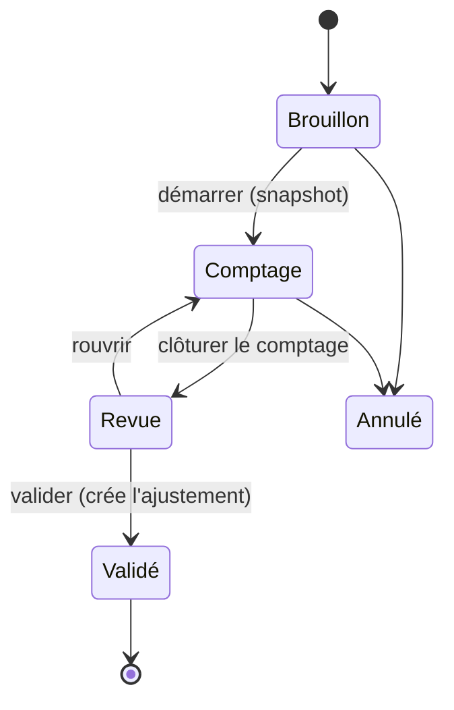

### 4.4. Ajustement de stock

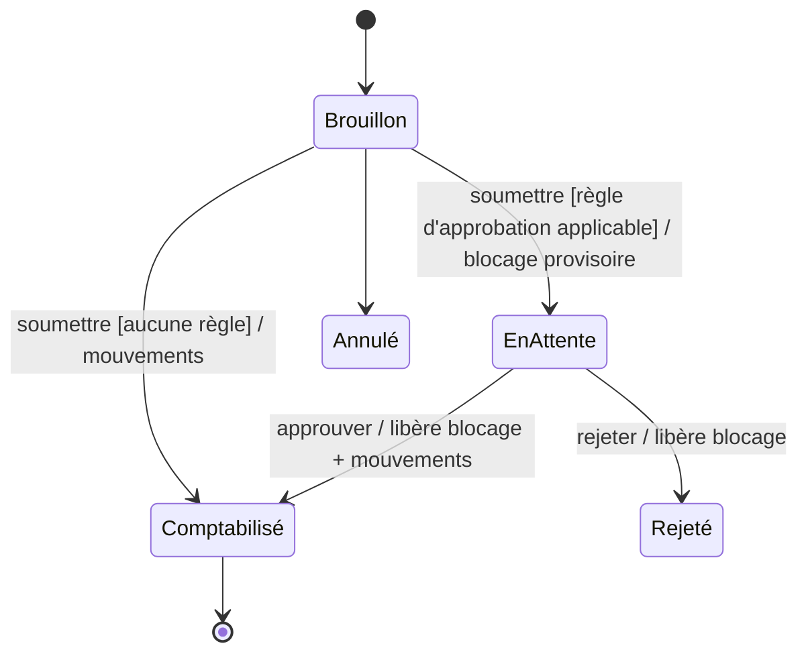

### 4.5. Transfert entre dépôts

| ID | Règle |
|---|---|
| TRF-001 | Les deux dépôts appartiennent à la même entreprise (garanti en base) et sont distincts. |
| TRF-002 | *Confirmé* : réservation de la quantité au dépôt source (source `transfer_line`). |
| TRF-003 | *En transit* : affectation des lots (FIFO proposé), mouvement `transfer_out` au dépôt source, quantité « en transit » portée par le transfert. |
| TRF-004 | *Réceptionné* : mouvement `transfer_in` au dépôt cible (même lot, même coût) pour la quantité reçue ; un écart (`envoyé − reçu`) génère une déclaration de perte (`loss`) traçable, soumise aux règles d'approbation d'ajustement. |
| TRF-005 | Aucun chiffre d'affaires ni mouvement financier. Le total entreprise (dépôts + transit) est inchangé hors écart déclaré. |
| TRF-006 | Annulation possible en *Brouillon* et *Confirmé* (libère la réservation) ; en *En transit*, seulement par réception au dépôt source (retour) — pas de suppression de mouvement. |

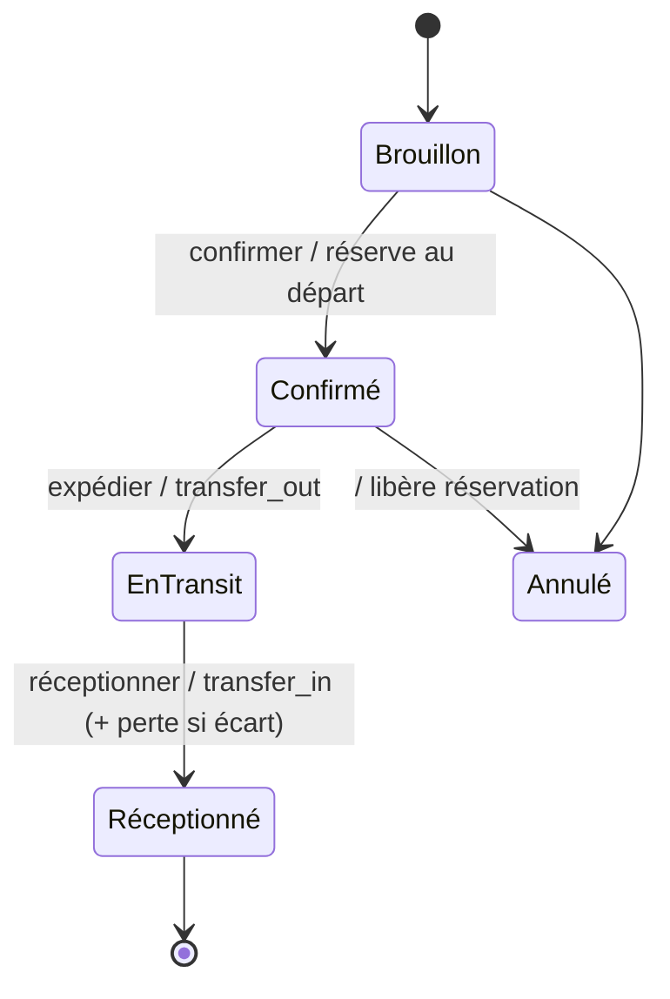

---

## 5. Achats et engagements fournisseurs

| ID | Règle | Statut |
|---|---|---|
| PUR-001 | La confirmation d'une commande d'achat crée un **engagement** (`supplier_bill`) du montant total dans la devise du BC. | D-026, Validé (2026-11-04) |
| PUR-002 | La dette fournisseur = Σ engagements − Σ règlements, **par devise** ; jamais confondue avec les dépenses. | VALIDÉ-CDC §7.3 |
| PUR-003 | Un règlement fournisseur enregistre le montant en devise de la dette, le montant débité du compte et le taux utilisé ; il ne peut excéder le solde des engagements alloués. | D-026 |
| PUR-004 | Un BC ne peut être annulé que s'il n'a aucune réception validée ; l'annulation solde l'engagement par un engagement négatif, après traitement des règlements éventuels (avoir fournisseur). | — |
| PUR-005 | Une réception partielle fait passer le BC en *Partiellement reçu* ; la clôture manuelle d'un BC partiellement reçu est possible (reliquat abandonné, engagement ajustable). | RECO-CDC §7.2 |

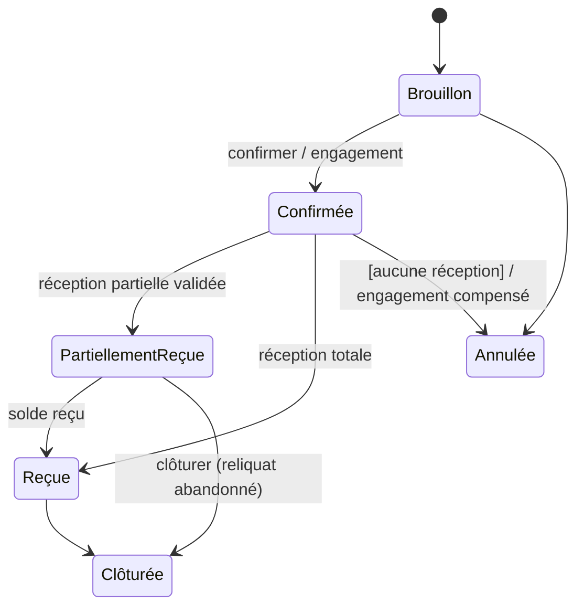

---

## 6. Arrivages, packing lists et réceptions

| ID | Règle | Statut |
|---|---|---|
| IMP-001 | L'import d'une packing list ne modifie jamais le stock. | VALIDÉ-CDC |
| IMP-002 | Un comptage non validé ne modifie pas le stock. | VALIDÉ-CDC |
| IMP-003 | La validation d'une réception crée, pour chaque ligne avec `accepté + endommagé (hold) > 0`, **un lot** et un mouvement `receipt` ; la quantité endommagée est immédiatement bloquée (`damaged`). | VALIDÉ-CDC, D-046 |
| IMP-004 | Une réception ne peut être validée qu'une fois (transition conditionnelle + unicité lot/ligne + unicité mouvement). | VALIDÉ-CDC |
| IMP-005 | Écarts (manquant, surplus, endommagé) conservés et consultables après clôture. | VALIDÉ-CDC |
| IMP-006 | Une packing list validée alimente les lignes attendues de l'arrivage ; chaque ligne doit être rattachée à une variante existante ou à un nouveau produit créé explicitement. | RECO-CDC |
| IMP-007 | Extraction PDF : aucune ligne n'est acceptée sans revue humaine (statut `confirmed`). | RECO-CDC §8.3 |
| IMP-008 | Un surplus (compté > attendu) est accepté uniquement avec la permission `goods_receipts.accept_surplus`. | — |
| IMP-009 | Plusieurs réceptions partielles par arrivage sont possibles (déchargement en plusieurs fois, plusieurs dépôts). | — |
| IMP-010 | Un scan code-barres est dédoublonné par `client_event_id` (renvois réseau). | — |

**Arrivage :**

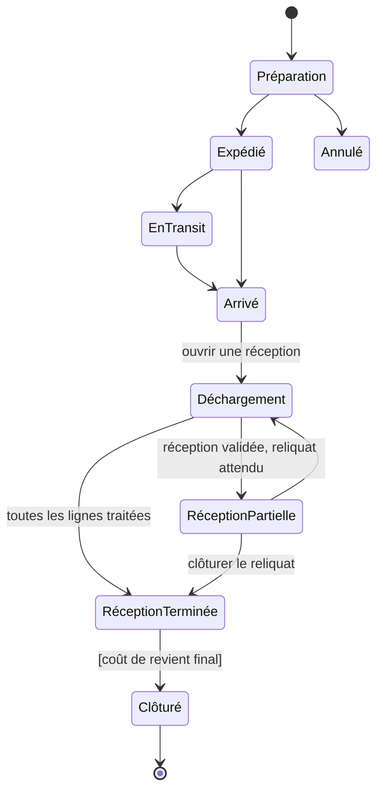

**Réception :**

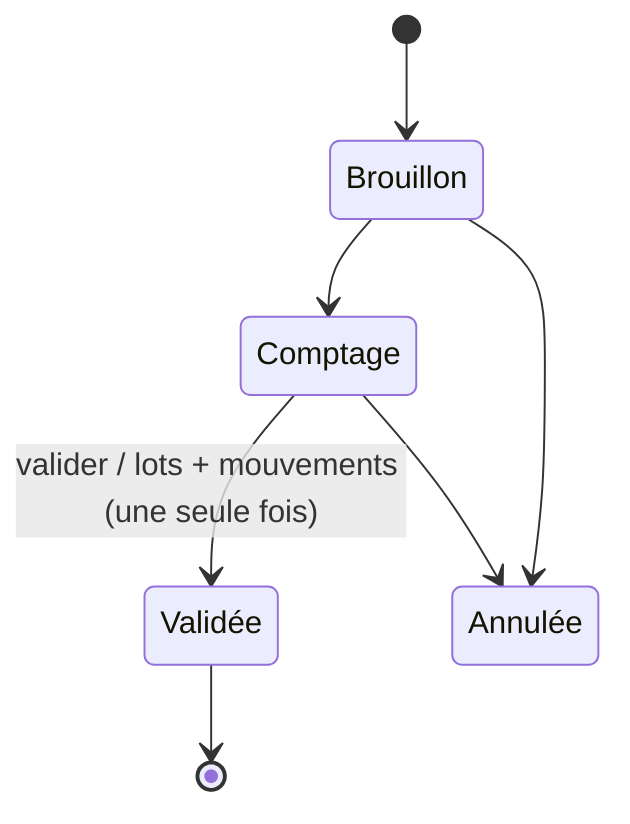

Correction d'une réception validée : document de correction générant des mouvements `reversal` (ou `adjustment_in`) sur les lots créés, jamais modification de la réception.

---

## 7. Coût de revient

### 7.1. Formule standard [VALIDÉ-CDC §9.3]

Pour chaque ligne *i* de l'arrivage, en devise de référence :

```
achat_converti_i  = montant_achat_devise_i × taux_i
part_frais_i      = frais_communs × (CBM_i / CBM_total_éligible)
coût_total_i      = achat_converti_i + part_frais_i + frais_directs_i
coût_pièce_i      = coût_total_i / qté_acceptée_i
coût_carton_i     = coût_pièce_i × pièces_par_carton_i
```

### 7.2. Règles

| ID | Règle | Statut |
|---|---|---|
| CR-001 | `CBM_total_éligible > 0` ; sinon blocage. | VALIDÉ-CDC |
| CR-002 | Chaque frais est réparti une seule fois (unicité frais × ligne × calcul ; un seul calcul `final` par arrivage). | VALIDÉ-CDC |
| CR-003 | Les taux utilisés sont enregistrés avec le calcul (`rates_snapshot`). | VALIDÉ-CDC |
| CR-004 | Un lot finalisé conserve son coût. | VALIDÉ-CDC |
| CR-005 | Une nouvelle version de formule ne recalcule pas l'historique. | VALIDÉ-CDC |
| CR-006 | Données manquantes (CBM, taux, quantité acceptée, prix d'achat, frais non confirmés) ⇒ finalisation bloquée, liste explicite des anomalies. | VALIDÉ-CDC |
| CR-007 | Affichage arrondi au franc (HALF_UP). | VALIDÉ-CDC, D-013 |
| CR-008 | Calculs internes en 8 décimales ; les parts de frais arrondies à 4 décimales sont réconciliées par **plus fort reste** : Σ parts = frais d'origine exactement. | RECO-CDC, D-014 |
| CR-009 | `CBM_i` est le volume total de la ligne ; si seul un CBM par carton est fourni, `CBM_i = CBM_carton × nb_cartons` (conversion explicite à l'import). | VALIDÉ-CDC §9.3 |
| CR-010 | Le coût des quantités **manquantes** n'est pas imputé au stock : la base de calcul de l'achat converti est le montant correspondant aux quantités acceptées + endommagées ; le montant des manquants est présenté comme écart (réclamation fournisseur). | PV-07, Validé (2026-11-04) |
| CR-011 | Les quantités **endommagées** reçues portent le même coût unitaire que les acceptées (elles sont dans le lot) ; leur perte éventuelle est constatée par ajustement. | PV-07, Validé (2026-11-04) |
| CR-012 | Les frais d'approche ne sont **pas** des dépenses du résultat de gestion. | D-027 |
| CR-013 | Réception avant coût final : lot `provisional` valorisé par (achat converti au taux estimé + frais estimés) ; à la finalisation, les lots passent `final` et chaque sortie déjà valorisée reçoit un `stock_valuation_adjustment` (Δ coût × quantité). | D-012, Validé (2026-11-04) |
| CR-014 | Formules personnalisées : moteur d'expressions restreint, versionné, testé avant activation. | RECO-CDC, D-015 |

### 7.3. Exemple de référence (TEST-009)

Frais communs 500 000 FCFA ; ligne A 2 m³, ligne B 3 m³ ⇒ A = 200 000, B = 300 000.
Exemple de réconciliation : 100 000 FCFA sur 3 lignes de 1 m³ ⇒ 33 333,3333 ×3 = 99 999,9999 ; le reste 0,0001 est attribué à la ligne de plus fort reste (puis par ordre de ligne) ⇒ Σ = 100 000,0000.

### 7.4. Machine à états du calcul

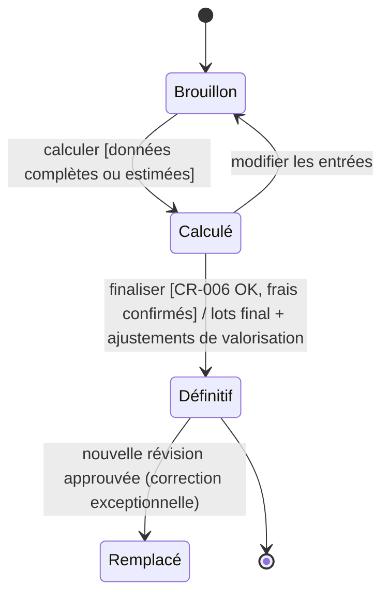

Une révision d'un calcul définitif (erreur de frais découverte après coup) est une **correction financière** soumise à approbation ; elle génère de nouveaux ajustements de valorisation sans modifier les lots rétroactivement dans l'historique (le lot conserve la trace des deux coûts).

---

## 8. Ventes

### 8.1. Devis

| ID | Règle |
|---|---|
| QUO-001 | Modifiable tant qu'il n'est pas *Accepté*/*Converti* ; aucun effet stock ni finance. |
| QUO-002 | La conversion crée une commande *Brouillon* reprenant les lignes ; les prix du devis sont conservés s'il est encore valide, sinon recalculés (avec avertissement). |
| QUO-003 | Un devis ne peut être converti qu'une fois. |

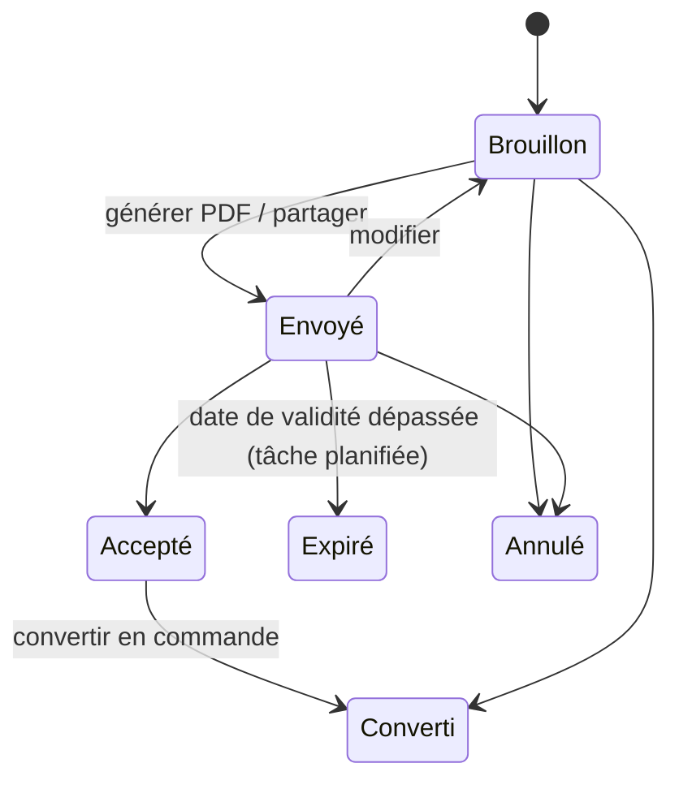

### 8.2. Commande client

| ID | Règle | Statut |
|---|---|---|
| CMD-001 | La confirmation réserve les quantités. | VALIDÉ-CDC |
| CMD-002 | L'expédition rend les quantités indisponibles. | VALIDÉ-CDC |
| CMD-003 | La remise déclenche la sortie définitive. | VALIDÉ-CDC |
| CMD-004 | Pas de confirmation sans réservation complète. | RECO-CDC |
| SAL-001 | Soumission d'une commande : évaluation des règles d'approbation (remise, prix modifié). Si une règle s'applique ⇒ *En attente d'approbation* + réservation **provisoire** ; sinon ⇒ *Confirmée* directement. | D-016 |
| SAL-002 | La confirmation (directe ou par approbation) émet la facture définitive dans la même transaction. | VALIDÉ-CDC §11.1 |
| SAL-003 | Une commande confirmée n'est pas modifiable ; réduction par avoir partiel, augmentation par commande complémentaire. | D-017 |
| SAL-004 | L'annulation d'une commande confirmée non livrée : libération des réservations, avoir total (`cancellation`) imputé sur la facture ; excédent payé ⇒ crédit client. Soumise à approbation si règle active. | D-019 |
| SAL-005 | Une commande partiellement livrée ne peut être annulée que pour son reliquat (avoir partiel). | D-022 |
| SAL-006 | Alerte « marge négative » si `prix net unitaire < coût estimé FIFO` à la confirmation (avertissement, non bloquant, sauf règle d'approbation). | CDC §15.2 |
| SAL-007 | Remises : par ligne (% ou montant) et globale (répartie au prorata sur les lignes pour le calcul). Arrondi par ligne. | D-013 |
| SAL-008 | Vente comptoir : enchaîne confirmation, facture, remise et paiement en une transaction ; échoue intégralement si l'une des étapes échoue. | D-063 |
| SAL-009 | Litige : indicateur indépendant de l'état ; ouvert/résolu avec motif. | D-025 |

États (`status`) :

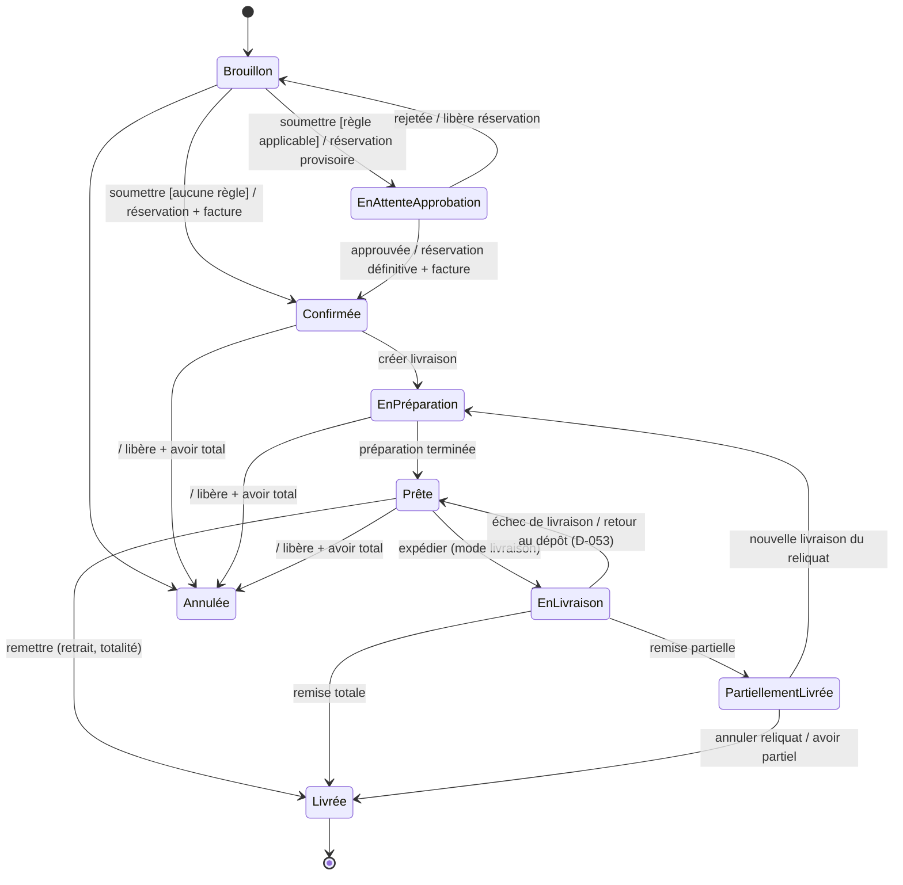

Les **retours** après livraison ne changent pas l'état de la commande (document `returns` lié, quantités `qty_returned`).

### 8.3. Livraison

| ID | Règle |
|---|---|
| DLV-001 | Une livraison porte sur tout ou partie des quantités restantes de la commande ; plusieurs livraisons par commande. |
| DLV-002 | *Expédiée* : affectation des lots (FIFO proposé), réservation consommée, « en livraison » incrémenté (position et lot). |
| DLV-003 | *Remise* : mouvement `sale_delivery` par lot au coût du lot, « en livraison » décrémenté, `qty_delivered` mis à jour. Coût des marchandises vendues constaté. |
| DLV-004 | Retrait sur place : *Prête → Remise* ; l'affectation de lot et le mouvement interviennent à la remise. |
| DLV-005 | *Échec* : « en livraison » → « réservé » (réservation reconstituée), motif obligatoire ; nouvelle tentative (`attempt+1`) ou annulation. |
| DLV-006 | Bon de livraison PDF généré à la préparation, régénéré (révision) à la remise avec les quantités effectives. |

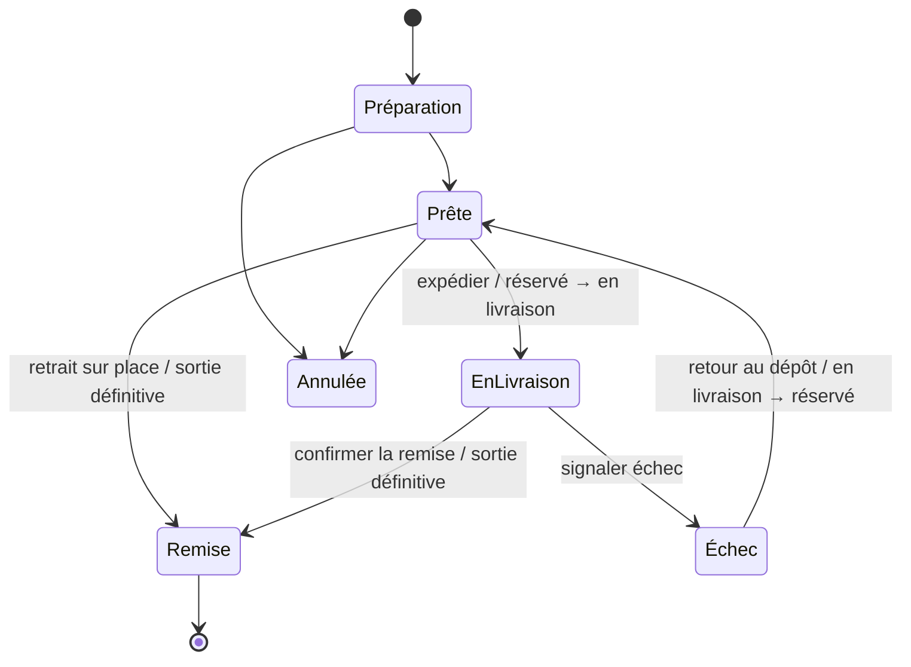

### 8.4. Retours

| ID | Règle | Statut |
|---|---|---|
| RET-001 | La remise en stock vendable est une décision explicite par ligne (`restock` / `damaged`). | VALIDÉ-CDC |
| RET-002 | Un retour endommagé entre en stock bloqué (`damaged`). | RECO-CDC |
| RET-003 | Le retour réintègre le **lot d'origine** au coût d'origine (mouvement `return_in`). | RECO-CDC, D-047 |
| RET-004 | Quantité retournée ≤ quantité livrée − déjà retournée. | — |
| RET-005 | Un retour accepté génère un avoir (`return`) du montant net facturé des quantités retournées, soumis aux règles d'approbation des avoirs ; un échange génère en plus une commande d'échange. | VALIDÉ-CDC §12.5 |
| RET-006 | Le coût des marchandises vendues est diminué du coût des quantités retournées ; le CA de gestion est diminué du montant de l'avoir. | D-018 |

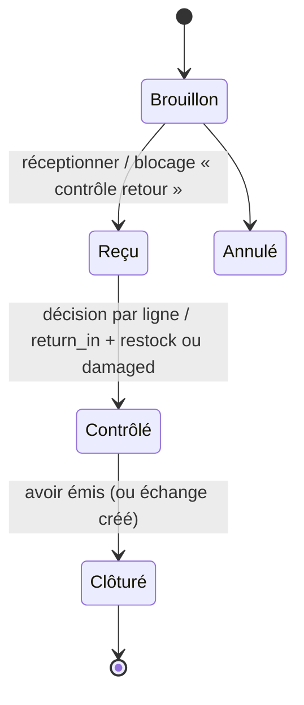

---

## 9. Facturation

| ID | Règle | Statut |
|---|---|---|
| BIL-001 | Numéro `FAC-AAAA-NNNN` attribué atomiquement à l'émission, séquence par entreprise et par année (année de la date d'émission, fuseau de l'entreprise), jamais réutilisé. | VALIDÉ-CDC, D-030 |
| BIL-002 | Une facture émise est immuable (lignes, montants, identités figées) ; seuls évoluent `amount_paid`, `amount_credited`, `payment_method`, `payment_status`, `status`. | VALIDÉ-CDC §11.4 |
| BIL-003 | Une facture n'est jamais supprimée ; son annulation totale se fait par avoir (`status = cancelled` quand Σ avoirs d'annulation = total). | VALIDÉ-CDC |
| BIL-004 | Échéance = date d'émission + délai client (ou entreprise) ; vente comptoir = date d'émission. | M-07 |
| BIL-005 | Taxes : calcul par ligne `tax = round(base_nette × taux)` ; aucun taux par défaut. | M-01, VÉRIF. RÉGL. |
| BIL-006 | Mentions légales figées dans `company_snapshot`. | VÉRIF. RÉGL. |
| BIL-007 | Statut de paiement : `unpaid` si réglé = 0, `partially_paid` si 0 < réglé < total, `paid` si réglé = total ; « En retard » dérivé (`due_date` dépassée et solde > 0). | VALIDÉ-CDC §12.3 |

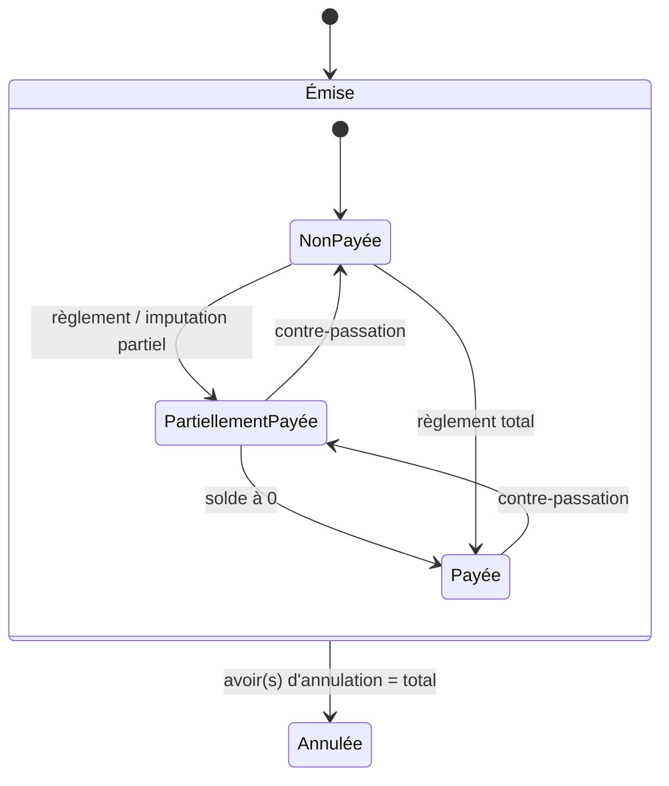

---

## 10. Paiements, créances, avoirs

| ID | Règle | Statut |
|---|---|---|
| PAY-001 | Le premier règlement fixe le moyen de paiement de la facture ; les suivants doivent utiliser le même (`409 payment_method_locked`). | RECO-CDC (PV-04) |
| PAY-002 | L'imputation d'un avoir n'est pas un moyen de paiement et n'est pas soumise à PAY-001. | D-020 |
| PAY-003 | Montant du règlement > 0 et ≤ solde dû (`422 overpayment`). | D-021 |
| PAY-004 | Le compte crédité doit être actif, de la devise de la facture, et de type correspondant au moyen (cash→caisse, wave→Wave, orange_money→OM, bank_transfer→banque). | — |
| PAY-005 | Un règlement crée dans la même transaction : mouvement financier `customer_receipt`, mise à jour de la facture, numéro de reçu `REC-AAAA-NNNN`. | VALIDÉ-CDC §12.4 |
| PAY-006 | Contre-passation d'un règlement : règlement négatif lié, mouvement financier inverse, solde rouvert ; soumise à la règle « correction financière ». Si plus aucun règlement monétaire actif, `payment_method` est remis à NULL. | D-059 |
| PAY-007 | Changement de moyen : contre-passation de tous les règlements puis nouvel enregistrement, sous approbation. | D-059 |
| CRN-001 | Un avoir (`AV-AAAA-NNNN`) est numéroté à l'émission ; brouillon et en attente non numérotés. | D-030 |
| CRN-002 | Avoir lié à une facture ⇒ imputé automatiquement sur le solde de cette facture à l'émission ; l'excédent reste disponible pour le client. | D-019 |
| CRN-003 | Une imputation ≤ min(disponible de l'avoir, solde dû de la facture) ; même client, même devise. | RECO-CDC §12.5 |
| CRN-004 | Avoir en attente d'approbation : montant affiché « En attente », non imputable. | VALIDÉ-CDC §16.4 |
| CRN-005 | Aucun décaissement d'avoir (pas de remboursement en espèces). | VALIDÉ-CDC, D-045 |

**Avoir :**

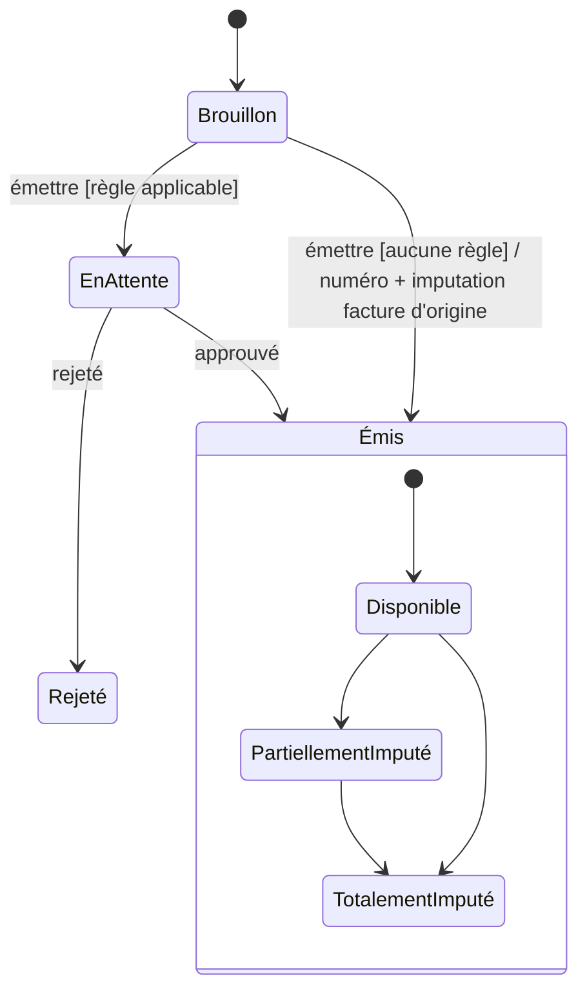

Exemple TEST-013 : avoir 20 000, imputation 8 000 ⇒ disponible 12 000.

---

## 11. Trésorerie et résultat

| ID | Règle | Statut |
|---|---|---|
| FIN-001 | Solde = ouverture + entrées validées − sorties validées. | VALIDÉ-CDC §14.3 |
| FIN-002 | Les opérations en attente d'approbation n'écrivent aucun mouvement financier ; elles figurent dans la rubrique « En attente ». | VALIDÉ-CDC, D-028 |
| FIN-003 | Solde négatif interdit sauf `allow_negative` (contrôle sous verrou du compte). | D-044 |
| FIN-004 | Transfert entre comptes : deux mouvements (`transfer_out`, `transfer_in`) dans une transaction ; taux obligatoire si devises différentes. | — |
| FIN-005 | Dépense : mouvement `expense` ; annulation par contre-écriture. | — |
| FIN-006 | Paiement de frais d'approche : mouvement `landed_cost_payment` (ou `supplier_payment` vers un transitaire), exclu des charges du résultat. | D-027 |
| FIN-007 | Les soldes d'ouverture sont saisis une seule fois (document d'ouverture), à la date de démarrage, en mouvements `opening`. | VALIDÉ-CDC §18.2 |

### 11.1. Indicateurs (définitions uniques)

| Indicateur | Définition (période P, devise de référence) | Statut |
|---|---|---|
| Montant facturé | Σ totaux des factures émises en P − Σ avoirs émis en P | — |
| **CA net de gestion** | Σ (montant net HT des lignes × quantité remise / quantité commandée) pour les remises datées en P − Σ avoirs de retour émis en P − Σ avoirs commerciaux émis en P | D-018, Validé (2026-11-04) |
| **Coût des marchandises vendues (CMV)** | Σ |`total_cost`| des mouvements `sale_delivery` en P − Σ `return_in` en P + Σ ajustements de valorisation datés en P | D-012 |
| **Marge commerciale brute** | CA net − CMV | VALIDÉ-CDC §14.5 |
| **Charges de la période** | Σ dépenses en P (hors frais d'approche) + Σ pertes et ajustements négatifs valorisés en P − Σ ajustements positifs valorisés en P | D-027, Validé (2026-11-04) |
| **Résultat net de gestion** | Marge brute − charges de la période | VALIDÉ-CDC §14.5 |
| Encaissements | Σ règlements clients en P | — |
| Créances | Σ soldes dus des factures émises à la date | — |
| Dettes fournisseurs | Σ soldes des engagements, par devise | — |
| Valeur du stock | Σ (physique par lot × coût unitaire du lot) ; mention « dont provisoire » | — |
| Rentabilité d'un arrivage | CA net et CMV des sorties des lots de l'arrivage | — |

L'interface présente séparément **marge**, **résultat**, **trésorerie** et **créances** [VALIDÉ-CDC §14.5].

---

## 12. Approbations

| ID | Règle | Statut |
|---|---|---|
| APR-001 | Opérations : remise, modification de prix, annulation, ajustement de stock, avoir, correction financière. | VALIDÉ-CDC §16.1 |
| APR-002 | Règle applicable = règle active de plus haute priorité correspondant à (opération, rôle du demandeur, seuil). Seuils : montant, pourcentage, quantité, toujours. | VALIDÉ-CDC §16.2 |
| APR-003 | L'approbateur doit détenir la permission de la règle ; l'auto-approbation est autorisée (sauf option `forbid_self_approval`) et marquée `self_approved`. | VALIDÉ-CDC, C-08 |
| APR-004 | Effets provisoires : réservation ou blocage de quantités, montant « En attente » ; aucun mouvement de stock ou financier définitif. | VALIDÉ-CDC §16.4 |
| APR-005 | Approbation : exécution de l'opération et levée des effets provisoires dans **une** transaction ; transition `pending → approved` conditionnelle (idempotente). | RECO-CDC §16.5 |
| APR-006 | Rejet / annulation par le demandeur : levée des effets provisoires ; historique conservé. | VALIDÉ-CDC |
| APR-007 | Si l'exécution échoue à l'approbation (ex. stock devenu insuffisant — impossible si la réservation provisoire est en place, mais possible pour une correction financière sur compte insuffisant), la demande reste *En attente* avec message d'erreur ; rien n'est écrit. | — |
| APR-008 | Aucune expiration automatique. | VALIDÉ-CDC |
| APR-009 | Notification in-app + e-mail aux détenteurs de la permission ; compteur tableau de bord. | VALIDÉ-CDC §16.5 |
| APR-010 | Une seule demande ouverte par (sujet, opération). | — |
| APR-011 | Entreprise suspendue : aucune décision possible. | RECO-CDC §3.5 |

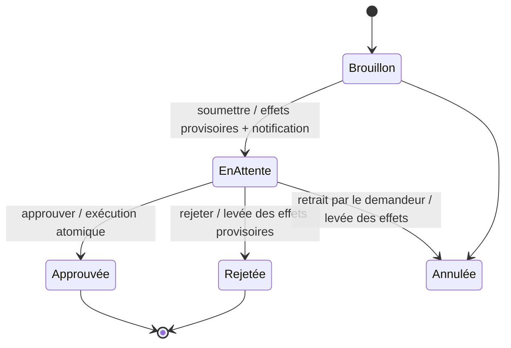

---

## 13. Multi-entreprises, administration, import

| ID | Règle |
|---|---|
| ADM-001 | Création d'entreprise atomique : entreprise, paramètres, séquences, rôles copiés des modèles, grilles tarifaires, comptes financiers par défaut (Caisse, Wave, Orange Money, Banque), catégories de frais et de dépenses, dépôt initial, invitation. L'e-mail d'invitation est envoyé **après commit**. [RECO-CDC §3.4] |
| ADM-002 | Invitation : jeton à usage unique, 72 h, révocable ; l'acceptation crée/active le compte rattaché à l'entreprise. |
| ADM-003 | Désactivation d'un utilisateur : révocation immédiate de toutes ses sessions. |
| ADM-004 | Un administrateur d'entreprise ne peut pas s'attribuer de permissions plateforme ni créer de super-admin. |
| ADM-005 | Le dernier administrateur actif d'une entreprise ne peut être désactivé. |
| IMPT-001 | Import en étapes : téléversement, correspondance, validation, prévisualisation (erreurs, doublons), correction, confirmation, import, rapport. [VALIDÉ-CDC §18.3] |
| IMPT-002 | Mode simulation : exécution complète dans une transaction annulée. |
| IMPT-003 | Import définitif tout-ou-rien par lot de fichier ; aucune écriture partielle si une ligne invalide n'a pas été exclue explicitement. |
| IMPT-004 | Doublons détectés : dans le fichier et contre la base (référence, SKU, code-barres, téléphone client). |
| IMPT-005 | Stock d'ouverture = lots `opening` + mouvements `opening` ; uniquement avant ou à la date de démarrage, document d'ouverture unique. |
| CONS-001 | Vue consolidée : sous-totaux par devise ; conversion uniquement avec devise de présentation choisie et taux daté affiché. [RECO-CDC §15.4] |

---

## 14. Matrice de cohérence détaillée (complète le CDC §26)

| Événement | Stock | Finance | Document | Audit |
|---|---|---|---|---|
| Soumission commande avec approbation | Réservation provisoire | Montant « En attente » | Demande APP | Oui |
| Confirmation commande | Réservation | Facture émise, créance | FAC | Oui |
| Expédition | Réservé → en livraison ; lots affectés | — | BL | Oui |
| Remise | Sortie `sale_delivery` | CMV ; CA de gestion | BL (révision) | Oui |
| Échec livraison | En livraison → réservé | — | — | Oui |
| Annulation avant livraison | Libération | Avoir d'annulation imputé ; excédent ⇒ crédit client | AV | Oui |
| Retour | `return_in` ; vendable ou bloqué | Avoir de retour ; CMV diminué | RET + AV | Oui |
| Paiement client | — | `customer_receipt` | REC | Oui |
| Contre-passation paiement | — | Mouvement inverse ; solde rouvert | Reçu d'annulation | Oui |
| Réception validée | Lots + `receipt` ; endommagé bloqué | Valorisation (provisoire ou finale) | BR | Oui |
| Finalisation coût | — | Lots `final` ; ajustements de valorisation | Fiche de coût | Oui |
| Confirmation BC | — | Engagement fournisseur | BC | Oui |
| Paiement fournisseur | — | `supplier_payment` ; dette diminuée | PF | Oui |
| Transfert | `transfer_out` / `transfer_in` (+ `loss`) | — | TRF | Oui |
| Ajustement approuvé | `adjustment_in/out` | Charge ou produit de gestion valorisé | AJU | Oui |
| Dépense | — | `expense` | DEP | Oui |
