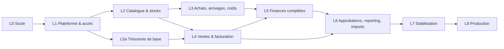

# 06 — Backlog de développement

**Version :** 1.0 — 4 novembre 2026
**Organisation :** livraison unique en production [VALIDÉ-CDC §1.3], travail en **lots techniques** ordonnés par dépendances. Chaque lot se termine par une démonstration en préproduction et une recette métier partielle.

---

## 1. Conventions

- **ID** : `L<lot>-<n°>`. **Taille** : S (≤ 1 j), M (2–3 j), L (4–6 j), XL (> 6 j, à découper avant démarrage).
- **Dépend de** : tickets à terminer avant démarrage.
- **Définition de terminé (DoD)** commune à tous les tickets :
  1. Code conforme à l'architecture (tests d'architecture verts, Larastan 8, ESLint).
  2. Migrations réversibles ; FK composites `company_id` sur toute nouvelle table métier.
  3. Contrat OpenAPI mis à jour ; réponses validées en test ; types TS régénérés.
  4. Tests : unitaires des règles, intégration des handlers, **test de non-fuite** des nouvelles routes (automatique), test de permission.
  5. Audit des actions sensibles ; champs sensibles masqués.
  6. Écran responsive (mobile vérifié), thème clair/sombre, messages d'erreur en français.
  7. Revue de code par un second agent/humain ; décisions nouvelles consignées dans `08`.

---

## 2. Vue d'ensemble des lots

> Les comptes financiers et le service de mouvements (L5a) sont avancés avant les ventes, car le paiement client en dépend. Le moteur d'approbation (L6-01) est conçu dès L1 sous forme d'**interface** (`ApprovalGate`) qui renvoie « pas d'approbation requise » jusqu'à son implémentation, pour ne pas bloquer L2–L4.

---

## L0 — Socle technique

| ID | Titre | Dépend de | Taille | Critères d'acceptation |
|---|---|---|---|---|
| L0-01 | Dépôt monorepo, structure `backend/ frontend/ openapi/ docker/ docs/` | — | S | Arborescence conforme à `02` §10 ; README d'installation |
| L0-02 | Docker Compose dev (app, queue, scheduler, nginx, mysql 8.4, redis, gotenberg, mailpit, frontend) | L0-01 | M | `make up` démarre la pile ; healthchecks verts ; Vite proxifie `/api` |
| L0-03 | Squelette Laravel (PHP 8.4), configuration MySQL strict, Redis, fuseau, locale fr | L0-02 | S | `php artisan app:health` OK |
| L0-04 | Squelette React + TS strict + Vite + Tailwind + shadcn/ui + thème clair/sombre + routeur | L0-02 | M | Page vide avec layout responsive et bascule de thème |
| L0-05 | Infrastructure modules (`app/Modules`, auto-chargement des routes/migrations par module, tests d'architecture Pest) | L0-03 | M | Un module exemple ; test arch qui échoue sur une dépendance interdite |
| L0-06 | Types valeur `Money`, `Quantity`, `Ulid`, `Rounding` (brick/math) + règle Larastan anti-`float` | L0-05 | M | Tests unitaires : arrondi HALF_UP par devise, somme, allocation au plus fort reste (propriétés : Σ parts = total) |
| L0-07 | Gestion des erreurs `problem+json`, codes, `X-Request-Id`, journaux JSON | L0-05 | S | Toutes les exceptions métier mappées ; aucune trace en prod |
| L0-08 | Middleware d'idempotence + table `idempotency_keys` | L0-05 | M | Rejeu identique ; `409 idempotency_conflict` ; purge planifiée |
| L0-09 | Contrat OpenAPI initial (components communs), Spectral, génération TS, validation des réponses en test | L0-05 | M | CI échoue si contrat invalide ou types non régénérés |
| L0-10 | CI GitHub Actions (lint, statique, tests MySQL réel, build front, audit) | L0-03, L0-04 | M | Pipeline vert sur PR |
| L0-11 | Déclencheurs d'immutabilité génériques (migration helper `appendOnly()`) | L0-05 | S | Test : UPDATE/DELETE sur table append-only ⇒ erreur SQL |
| L0-12 | Service `DocumentSequence` (numérotation atomique par entreprise/type/année) | L0-05 | M | Test de concurrence : 50 attributions parallèles ⇒ 50 numéros distincts consécutifs (TEST-021) |
| L0-13 | Service fichiers privés (upload, détection MIME, ULID, téléchargement via policy) | L0-05 | M | Fichier d'une autre entreprise ⇒ 404 ; extension falsifiée refusée |
| L0-14 | Service PDF (Gotenberg, gabarit A4 de base, stockage `generated_documents`) | L0-13 | M | PDF A4 généré via job ; empreinte stockée |

## L1 — Plateforme, identité, accès, audit

| ID | Titre | Dépend de | Taille | Critères d'acceptation |
|---|---|---|---|---|
| L1-01 | Tables `companies`, `currencies` (seed XOF, EUR, USD, CNY), `company_settings` | L0-05 | S | Contraintes conformes à `03` |
| L1-02 | `TenantContext`, middleware `ResolveCompanyContext`, trait `BelongsToCompany` (*fail closed*), cache préfixé, jobs `TenantAware` | L1-01 | L | Requête sans contexte ⇒ exception ; job rétablit le contexte ; tests d'isolation de base |
| L1-03 | **Test générique de non-fuite** parcourant toutes les routes | L1-02 | L | Échoue si une route renvoie une ressource de B à un utilisateur de A ; s'exécute en CI à chaque PR |
| L1-04 | Utilisateurs (`users` + CHECK super-admin), authentification Sanctum SPA, session 240 min, Argon2id | L1-01 | M | Login/logout/me ; expiration à 240 min d'inactivité ; régénération de session |
| L1-05 | Limitation de débit connexion, alerte connexion super-admin | L1-04 | S | 6e tentative ⇒ 429 ; e-mail d'alerte super-admin |
| L1-06 | Réinitialisation du mot de passe (jeton usage unique 60 min) | L1-04 | S | Jeton réutilisé ⇒ refus ; réponse constante |
| L1-07 | Rôles et permissions (spatie teams), catalogue de permissions, modèles de rôles par défaut | L1-04 | M | Matrice `04` §2 seedée ; policy de base |
| L1-08 | Audit : `audit_logs` append-only, `AuditRecorder`, observateur des données de référence | L1-02 | M | Valeurs avant/après ; journal des connexions |
| L1-09 | Création atomique d'entreprise (ADM-001) + invitation après commit | L1-07, L1-08, L0-12 | L | Échec simulé à mi-parcours ⇒ aucune donnée résiduelle ; e-mail envoyé uniquement après commit |
| L1-10 | Invitations et acceptation | L1-09 | M | Jeton 72 h, usage unique ; compte rattaché à l'entreprise |
| L1-11 | Sélecteur d'entreprise super-admin (session serveur, audit MT-008) | L1-02, L1-08 | M | TEST-002 ; utilisateur ordinaire ⇒ 403 |
| L1-12 | Suspension / réactivation + middleware `EnsureCompanyWritable` + garde des jobs | L1-09 | M | TEST-018 ; jobs refusés ; super-admin bloqué en écriture métier |
| L1-13 | Gestion des utilisateurs de l'entreprise (inviter, rôles, désactiver ⇒ révocation sessions, ADM-005) | L1-10 | M | Désactivation ⇒ session active invalidée immédiatement |
| L1-14 | Paramètres entreprise, séquences documentaires (préfixes), taux de change, taxes (vide) | L1-09 | M | Modification sans code (CDC §1.4) |
| L1-15 | Interface `ApprovalGate` (stub « non requis ») | L0-05 | S | Utilisable par les modules L2–L5 |
| L1-16 | Écrans : connexion, mot de passe oublié, invitation, entreprises (super-admin), utilisateurs & rôles, paramètres, sélecteur | L1-04…L1-14 | L | Parcours E2E Playwright verts |

**État au 2026-11-05 :** L1-01 à L1-15 livrés et testés (165 tests backend, test générique de non-fuite, contrat OpenAPI validé).
L1-16 : écrans livrés (connexion, mot de passe, invitation, entreprises, utilisateurs, rôles, paramètres, audit, sélecteur) et testés
avec Vitest ; **les parcours Playwright de bout en bout restent à écrire** (prévus avec la chaîne E2E de `07` §7).

## L5a — Trésorerie de base (avancée)

| ID | Titre | Dépend de | Taille | Critères d'acceptation |
|---|---|---|---|---|
| L5a-01 | Comptes financiers (création par défaut à la création d'entreprise) | L1-09 | S | 4 comptes par défaut |
| L5a-02 | Service `FinancialLedger` : mouvements append-only, verrou du compte, solde projeté, contrôle `allow_negative`, contre-écriture | L5a-01, L0-11 | M | Solde = Σ mouvements ; solde négatif refusé ; concurrence sur un compte |

## L2 — Catalogue et stocks

| ID | Titre | Dépend de | Taille | Critères d'acceptation |
|---|---|---|---|---|
| L2-01 | Catégories (arborescence) | L1-02 | S | Unicité par parent |
| L2-02 | Produits + variante par défaut, attributs et variantes, statut, `has_history` | L2-01 | L | CAT-001, CAT-002, CAT-006 (critère §5.4) |
| L2-03 | Conditionnements et codes-barres (`variant_units`), lookup code-barres | L2-02 | M | Unicité code-barres ; facteur figé une fois utilisé (CAT-007) |
| L2-04 | Grilles tarifaires et prix datés, service de prix proposé | L2-03 | M | CAT-004 ; pas de chevauchement de périodes |
| L2-05 | Photos produits (miniatures, EXIF supprimé, chargement progressif) | L2-02, L0-13 | M | Liste produits avec photo < 3 s pour 2 000 produits |
| L2-06 | Dépôts, dépôt par défaut | L1-02 | S | — |
| L2-07 | Tables stock : lots, positions, soldes lot, mouvements (append-only, unicité source), réservations, blocages + CHECK | L2-06, L2-03 | L | Insertion violant un CHECK ⇒ erreur SQL ; doublon de mouvement ⇒ erreur SQL |
| L2-08 | Service `StockLedger` : `postMovement`, `reserve`, `release`, `consumeToDelivery`, `hold`, verrous ordonnés, reprise sur interblocage | L2-07 | XL→ découper : (a) mouvements, (b) réservations, (c) blocages/en livraison | TEST-003, TEST-005, TEST-006 (concurrence), invariants compartiments |
| L2-09 | Allocateur FIFO + affectation manuelle | L2-08 | M | Ordre FIFO ; lot bloqué/en livraison exclu ; quantité manuelle > lot ⇒ refus |
| L2-10 | Rapprochement `inventory:reconcile` + alerte | L2-08 | S | Écart injecté ⇒ alerte |
| L2-11 | Ajustements de stock (brouillon → comptabilisé), lot d'ajustement, blocage provisoire via `ApprovalGate` | L2-08, L1-15 | M | INV-005…007 |
| L2-12 | Inventaires (snapshot, comptage, revue, validation ⇒ ajustement), feuille PDF | L2-11, L0-14 | L | INV-101…105 |
| L2-13 | Transferts (confirmé, en transit, réceptionné, écart ⇒ perte) | L2-09 | L | TRF-001…006 ; total entreprise inchangé |
| L2-14 | Consultation stocks : positions (compartiments + attendu + transit), lots, mouvements, alertes stock faible | L2-08 | M | Formule §6.3 affichée sans double soustraction |
| L2-15 | Écrans : produits, catégories/variantes, dépôts, stocks, inventaires (mobile + lecteur), transferts | L2-02…L2-14 | XL→ découper par écran | E2E |

**État au 2026-11-05 :** L2-01 à L2-14 livrés et testés (grand livre, compartiments, FIFO, ajustements, inventaires, transferts, rapprochement, test de concurrence TEST-006, non-fuite étendue, contrat OpenAPI).
L2-15 : écrans livrés (produits, catalogue, stocks, dépôts, ajustements, inventaires avec lecteur de code-barres, transferts) ; parcours E2E à écrire avec ceux du lot 1.
Non couvert à ce stade : mesure de performance « 2 000 produits avec photo < 3 s » (L2-05), à faire en préproduction (07 §8).

## L3 — Achats, arrivages, coûts de revient

| ID | Titre | Dépend de | Taille | Critères d'acceptation |
|---|---|---|---|---|
| L3-01 | Fournisseurs (types, devise), masquage sensible | L1-02 | S | GEN-005 |
| L3-02 | Commandes d'achat + engagement à la confirmation | L3-01, L2-03 | M | PUR-001, PUR-004 |
| L3-03 | Engagements et paiements fournisseurs (allocation, taux, mouvement financier) | L3-02, L5a-02 | M | PUR-002, PUR-003 ; dette par devise |
| L3-04 | Arrivages, conteneurs, liaison BC, lignes attendues, états | L3-02, L2-06 | M | Machine à états `04` §6 ; stock attendu visible, non vendable (ST-001) |
| L3-05 | Moteur d'import générique (pipeline, mapping, validation, simulation) — **partagé avec L6** | L0-13 | L | IMPT-001…004 |
| L3-06 | Packing list Excel/CSV → lignes, rapprochement variantes, création de produits | L3-05, L3-04 | L | IMP-001, IMP-006 |
| L3-07 | Packing list PDF (pdftotext + modèles fournisseurs), revue humaine obligatoire | L3-06 | L | IMP-007 ; tests sur exemples réels (PV-09) |
| L3-08 | Réceptions : saisie manuelle, scan (dédoublonnage), écarts | L3-04, L2-03 | M | IMP-002, IMP-008, IMP-010 |
| L3-09 | Validation de réception : lots, mouvements, blocage endommagés, coût provisoire | L3-08, L2-08 | L | TEST-007, TEST-008, IMP-003…005 |
| L3-10 | Frais d'approche (catégories, frais directs, engagement transitaire) | L3-04, L3-03 | M | CR-012 |
| L3-11 | Moteur d'expressions (parser, AST, BigDecimal, liste blanche, versions) | L0-06 | L | Aucune exécution arbitraire ; tests de fuzzing ; CR-014 |
| L3-12 | Calcul du coût de revient (formule standard, plus fort reste, anomalies bloquantes, snapshot des taux) | L3-09, L3-10, L3-11 | L | TEST-009, TEST-010, CR-001…010 ; reproductibilité (même entrées ⇒ même `inputs_hash` et mêmes résultats) |
| L3-13 | Finalisation : lots `final`, ajustements de valorisation des sorties déjà valorisées | L3-12, L4-07 (pour tester avec sorties ; peut démarrer avant) | M | CR-004, CR-013 |
| L3-14 | Écrans : fournisseurs, achats, arrivages, packing lists (revue ligne à ligne), réceptions (mobile + lecteur), coûts | L3-01…L3-13 | XL→ découper | E2E |

**État au 2026-11-06 :** L3-01, L3-02, L3-04, L3-06, L3-08 à L3-12 livrés et testés (exemple de référence TEST-009, plus fort reste, reproductibilité, réception unique, dédoublonnage des scans, surplus, non-fuite, contrat OpenAPI).
L3-03 : engagements, avoirs et relevé par devise livrés ; **règlements fournisseurs reportés au lot 5a** (comptes financiers, D-087).
L3-05 : lecture CSV/Excel, correspondance des colonnes et contrôles livrés ; file d'attente et simulation à compléter avec L6-08 (D-092).
L3-07 : **non commencé**, en attente d'exemples réels de packing lists PDF (PV-09, D-091).
L3-13 : finalisation et ajustements de valorisation livrés et testés sur des sorties de perte ; à retester avec les livraisons clients (L4-07).
L3-14 : écrans livrés (fournisseurs et relevé, commandes, arrivages, packing lists, réceptions avec lecteur, frais et calculs) ; parcours E2E à écrire.

## L4 — Ventes, livraisons, facturation

| ID | Titre | Dépend de | Taille | Critères d'acceptation |
|---|---|---|---|---|
| L4-01 | Clients (grille par défaut, délai de paiement), recherche par téléphone | L2-04 | S | — |
| L4-02 | Devis + PDF + partage WhatsApp (lien signé) | L4-01, L0-14 | M | QUO-001…003 |
| L4-03 | Commandes brouillon : lignes, unités, prix proposé, remises, taxes, totaux arrondis | L4-01, L2-04 | L | SAL-007 ; TEST-022 (2 cartons + 3 pièces = 15) |
| L4-04 | Factures : émission atomique, snapshots, numérotation | L4-03, L0-12 | M | BIL-001, BIL-002, TEST-021 |
| L4-05 | Soumission/confirmation : réservation complète + facture, `ApprovalGate`, alerte marge négative | L4-04, L2-08 | L | CMD-001, CMD-004, SAL-001, SAL-002, SAL-006, TEST-003, TEST-005, TEST-006 |
| L4-06 | Livraisons : création partielle, préparation, BL PDF | L4-05 | M | DLV-001, DLV-006 |
| L4-07 | Expédition / remise / retrait / échec / retour au dépôt (affectation lots, CMV) | L4-06, L2-09 | L | DLV-002…005, TEST-004 |
| L4-08 | Avoirs (brouillon, émission, imputation auto sur facture d'origine, crédit client) | L4-04 | M | CRN-001…005, TEST-013 |
| L4-09 | Annulation de commande (totale, reliquat) | L4-05, L4-08 | M | SAL-004, SAL-005 |
| L4-10 | Paiements clients, reçus, PAY-001, comptes par type | L4-04, L5a-02 | M | PAY-001…005, TEST-011, TEST-012 |
| L4-11 | Contre-passation de paiement, changement de moyen | L4-10 | M | PAY-006, PAY-007 |
| L4-12 | Retours (réception, contrôle, restock/damaged, avoir, échange) | L4-07, L4-08 | L | RET-001…006, TEST-014 |
| L4-13 | Vente comptoir (transaction unique) | L4-05, L4-07, L4-10 | M | SAL-008 ; échec paiement ⇒ rien n'est écrit |
| L4-14 | Litiges | L4-05 | S | SAL-009 |
| L4-15 | Créances, relances WhatsApp, relevé client PDF | L4-10, L4-08 | M | §12.3, §12.6 |
| L4-16 | Écrans : clients, devis, commandes, **saisie rapide/comptoir (mobile prioritaire)**, factures, livraisons, retours/avoirs, paiements, créances | L4-01…L4-15 | XL→ découper | E2E ; vente comptoir en < 30 s pour un utilisateur entraîné |

**État au 2026-11-07 :** L4-01 à L4-15 livrés et testés (TEST-011 à TEST-014, TEST-021, TEST-022, vente comptoir atomique, non-fuite, contrat OpenAPI), ainsi que L5a-01 et L5a-02 (trésorerie de base, D-102).
L4-02 et L4-15 : PDF générés à la demande par Gotenberg, lien signé et message WhatsApp prérempli ; l'envoi reste une action de l'utilisateur.
L4-16 : écrans livrés (vente comptoir mobile, commandes et livraisons, factures et règlements, créances, clients) ; devis, retours et avoirs disponibles par l'API, écrans dédiés à compléter ; parcours E2E à écrire.

## L5 — Finances complètes

| ID | Titre | Dépend de | Taille | Critères d'acceptation |
|---|---|---|---|---|
| L5-01 | Transferts entre comptes (multi-devises) | L5a-02 | S | FIN-004 |
| L5-02 | Dépenses, catégories, justificatif, contre-écriture | L5a-02, L0-13 | M | FIN-005 |
| L5-03 | Corrections financières (via `ApprovalGate`) | L5a-02, L1-15 | M | Aucun mouvement avant approbation (FIN-002) |
| L5-04 | Document d'ouverture : soldes financiers, stock initial (lots `opening`), coûts initiaux | L5a-02, L2-08 | M | FIN-007, IMPT-005 ; pas de vente/achat créé |
| L5-05 | Service d'indicateurs financiers (CA net, CMV, marge, charges, résultat) — définitions `04` §11.1 | L4-07, L4-12, L5-02, L3-13 | L | Jeux de données de référence calculés à la main ⇒ résultats identiques au franc près |
| L5-06 | Écrans : comptes, mouvements, transferts, dépenses, rubrique « En attente », ouverture | L5-01…L5-04 | L | E2E |

**État au 2026-11-08 :** L5-01 à L5-05 livrés et testés (jeu de référence calculé à la main : CA net 8 000, CMV 4 800, marge 3 200, charges 500, résultat 2 700). L5-06 : écran Trésorerie (soldes, transferts, dépenses, en attente) ; l'ouverture se saisit par l'API, écran dédié à compléter.

## L6 — Approbations, notifications, reporting, imports

| ID | Titre | Dépend de | Taille | Critères d'acceptation |
|---|---|---|---|---|
| L6-01 | Moteur d'approbation (règles, demandes, décisions, idempotence, effets provisoires) — remplace le stub | L1-15, L4-05, L2-11, L4-08, L5-03 | L | APR-001…011, TEST-015, TEST-016 ; double approbation concurrente ⇒ un seul effet |
| L6-02 | Branchement des 6 opérations (remise, prix, annulation, ajustement, avoir, correction) | L6-01 | L | Chaque opération testée approuvée / rejetée / annulée |
| L6-03 | Notifications in-app + e-mail (queue), compteur | L6-01 | M | APR-009 |
| L6-04 | Tableau de bord entreprise (indicateurs `15.1`, filtres `15.3`) | L5-05 | L | < 3 s sur jeu de volumétrie cible |
| L6-05 | Alertes (`15.2`) | L6-04 | M | Chaque alerte testée |
| L6-06 | Rapports (liste `05` §2.9) + exports CSV/XLSX/PDF asynchrones respectant permissions | L6-04 | XL→ découper par rapport | TEST-017 (API + export refusés) |
| L6-07 | Vue consolidée super-admin (par devise, conversion explicite) | L6-04 | M | TEST-023 |
| L6-08 | Imports initiaux : produits, stock d'ouverture, clients, fournisseurs + modèles | L3-05, L5-04 | L | TEST-019 ; simulation sans écriture |
| L6-09 | Recherche globale | L4-16 | M | Produits, clients, numéros de documents ; isolation |
| L6-10 | Journal d'audit consultable (filtres, détail avant/après) | L1-08 | M | TEST-024 |
| L6-11 | Écrans : approbations, notifications, tableau de bord, rapports, imports, audit | L6-01…L6-10 | XL→ découper | E2E |

**État au 2026-11-09 :** L6-01 à L6-10 livrés et testés (TEST-015, TEST-016, TEST-017, TEST-019, TEST-023 ; double décision ⇒ un seul effet ; auto-approbation paramétrable). L6-11 : écrans approbations, notifications, recherche, tableau de bord avec alertes et indicateurs, rapports avec export CSV ; écran d'import à compléter (API disponible).

## L7 — Stabilisation

| ID | Titre | Dépend de | Taille | Critères d'acceptation |
|---|---|---|---|---|
| L7-01 | Campagne de tests de concurrence (stock, paiements, séquences, approbations) | L6 | M | Rapport ; 0 anomalie |
| L7-02 | Campagne d'isolation (routes, fichiers, exports, jobs, cache, recherche) | L6 | M | 0 fuite |
| L7-03 | Tests de sécurité (OWASP ASVS niveau 2 ciblé, ZAP baseline, revue manuelle auth/upload) | L6 | L | 0 vulnérabilité critique/majeure ouverte |
| L7-04 | Tests de performance k6 (volumétrie cible × 3) + optimisation | L6 | M | p95 API < 800 ms ; pages < 3 s |
| L7-05 | Recette métier complète TEST-001…024 + scénarios bout en bout | L6 | L | PV de recette |
| L7-06 | Revue des documents PDF (factures, avoirs, reçus) avec l'expert-comptable | L4, PV-01 | S | Mentions validées |
| L7-07 | Documentation utilisateur (par profil) et documentation d'exploitation | L6 | M | — |

**État au 2026-11-09 :** L7-01 (concurrence : stock, séquences, paiements, approbations), L7-02 (non-fuite sur toutes les routes), L7-03 (revue `12-securite.md`, audit des dépendances, limitation de débit, modèle d'environnement de production), L7-05 (traçabilité `11-recette.md`, TEST-001…024 automatisés sauf TEST-020) et L7-07 (`09-exploitation.md`, `10-guide-utilisateur.md`) réalisés.
À faire en préproduction : L7-04 (exécuter `perf/k6/api-load.js`), analyse ZAP, L7-06 (revue des documents par l'expert-comptable), parcours E2E Playwright.

## L8 — Mise en production

| ID | Titre | Dépend de | Taille | Critères d'acceptation |
|---|---|---|---|---|
| L8-01 | Provisionnement VPS (durcissement SSH, pare-feu, mises à jour automatiques de sécurité) | — | M | Checklist |
| L8-02 | Docker Compose prod, Caddy HTTPS, secrets | L8-01 | M | SSL Labs A ; aucun port interne exposé |
| L8-03 | Sauvegardes restic externes + test de restauration automatisé en préproduction | L8-02 | M | TEST-020 démontré |
| L8-04 | Supervision (santé, disque, files, sauvegardes, disponibilité HTTP, CPU/RAM), alertes | L8-02 | M | Alerte reçue sur incident simulé |
| L8-05 | SMTP transactionnel (SPF, DKIM, DMARC) | L8-02 | S | E-mails non classés en spam (PV-10) |
| L8-06 | Préproduction validée, migration des données initiales (imports), ouverture | L7, L8-03 | M | Critères CDC §28 tous satisfaits |
| L8-07 | Mise en service et hypercare (2 semaines) | L8-06 | — | — |

**État au 2026-11-09 :** artefacts prêts — `ops/provision-vps.sh` (L8-01), `docker-compose.prod.yml` + Caddy + `.env.production.example` + `ops/deploy.sh` (L8-02), service `backup` restic et `restore-test.sh` (L8-03), `ops/monitor.sh` (L8-04), procédure SMTP (L8-05, `09-exploitation.md`).
**Bloquant côté maître d'ouvrage :** serveur, nom de domaine, fournisseur SMTP, dépôt de sauvegarde externe (PV-10, PV-12) ; L8-06 et L8-07 se déroulent sur cette infrastructure.

---

## 3. Chemin critique

`L0-05 → L0-06 → L1-02 → L1-03 → L2-07 → L2-08 → L4-05 → L4-07 → L5-05 → L6-04 → L7 → L8`

Les risques de ce chemin sont l'**isolation** (L1-02/03) et le **moteur de stock** (L2-08) : ils sont réalisés en premier, avec la plus forte exigence de tests, car tous les modules suivants s'appuient dessus.

## 4. Pré-requis métier par lot

| Avant le lot | Fournir |
|---|---|
| L2 | Exemple réel de catalogue (références, variantes, conditionnements) |
| L3 | 3 à 5 packing lists réelles (Excel et PDF) par fournisseur principal (PV-09) ; un arrivage réel avec tous ses frais |
| L4 | Validation des points D-016…D-022 ; politique tarifaire gros/détail |
| L5 | Validation des définitions d'indicateurs (`04` §11.1) |
| L6 | Seuils d'approbation initiaux (PV-13) |
| L7 | Mentions légales et règles fiscales (PV-01) |
| L8 | Choix SMTP, stockage de sauvegarde, nom de domaine, RPO/RTO (PV-10, PV-12) |
